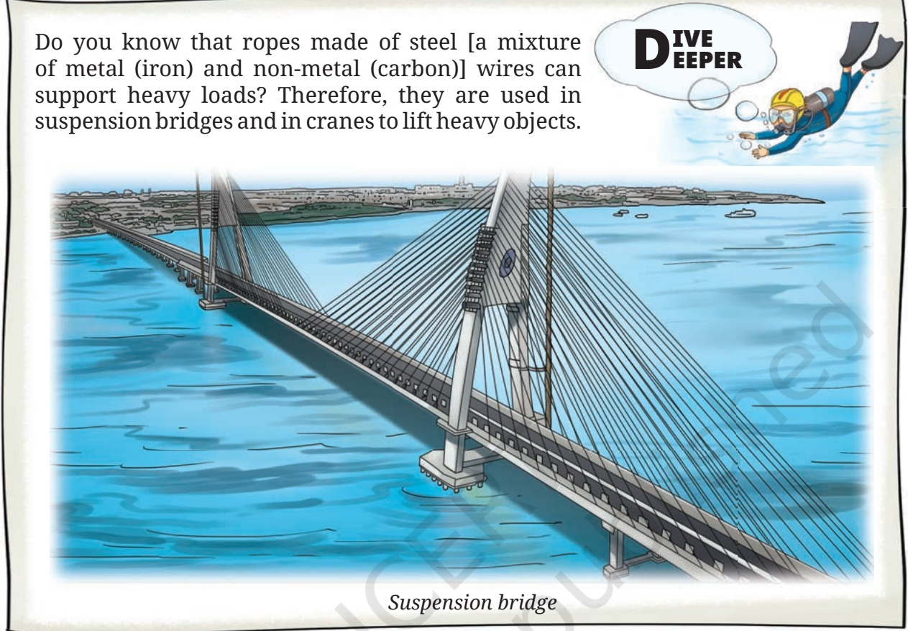
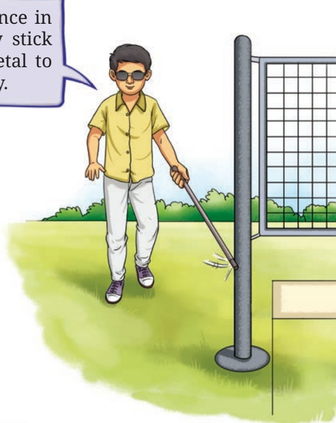

Have you ever seen wires made of coal or sulfur? Obviously not! We can say that coal and sulfur are not ductile.

Do you know that ropes made of steel [a mixture of metal (iron) and non-metal (carbon)] wires can support heavy loads? Therefore, they are used in suspension bridges and in cranes to lift heavy objects.

## 4.1.3 Sonority

Have you ever noticed the sound produced when a metal spoon, or a metal plate, or a metal coin is dropped on the floor? How is it different from the sound produced when a piece of coal or wood is dropped on the floor?

**Activity 4.2: Let us investigate**

**Caution**— Be careful while dropping the objects.

Take a few objects, such as a metal spoon, a coin, a piece of coal, and a block of wood.

I use the difference in sound when my stick hits wood or metal to help find my way.

Drop them one by one from a certain height.

Do you notice any difference in the sound produced by these objects?

