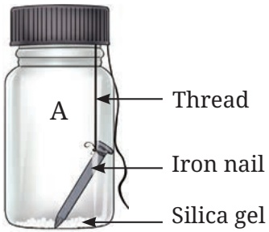
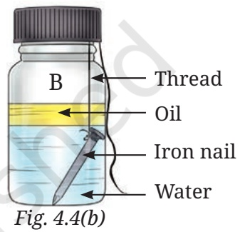
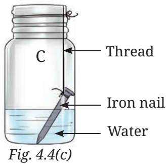

## Activity 4.5: Let us experiment

**Caution**— Be careful while handling iron nails.

Take a few shining iron nails. If you are using old iron nails, make sure to remove brown deposits from their surface by scrubbing them with the help of a small piece of sandpaper.

Take three clean, dry glass bottles or test tubes with tight-fitting caps or stoppers. Label them A, B, and C.

Take three iron nails and tie each iron nail with a thread.

Place one iron nail and some silica gel in the glass bottle ‘A’, and tighten the cap or stopper (Fig. 4.4a). Silica gel makes the air dry. It is the substance that is used in small pouches in some medicine bottles, water bottles, shoe boxes, etc., to keep them dry.

Fig. 4.4(a)

Place one iron nail in the glass bottle ‘B’. Pour freshly boiled and cooled water (to remove dissolved gases) into it until the iron nail is completely dipped in it. Now, pour some oil to form a layer over the surface of the water (Fig. 4.4b). The layer of oil on the surface of the water prevents the air from dissolving in the water. Cap the glass bottle tightly.

Place one iron nail in the glass bottle ‘C’, and pour some water so that the iron nail is partially dipped. Keep this glass bottle unstoppered. This allows the iron nail to come into contact with both water and air, as shown in Fig. 4.4c.

Fig. 4.4(c)

Fig. 4.4: Glass bottles containing iron nails

Place all the glass bottles undisturbed at room temperature and observe the changes for 8 – 10 days.

Record your observations in Table 4.3.

Table 4.3: Formation of brown deposit on iron nails

<table><tr><td rowspan="2">Glass Bottle</td><td colspan="2">Conditions</td><td rowspan="2">Observations</td></tr><tr><td>Presence of water (Yes/No)</td><td>Presence of air (Yes/No)</td></tr><tr><td>A</td><td>No</td><td>Yes</td><td></td></tr><tr><td>B</td><td></td><td></td><td></td></tr><tr><td>C</td><td></td><td></td><td></td></tr></table>