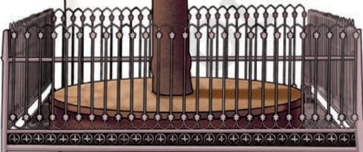

## What can you conclude from this experiment?

It is observed in glass bottles A and B that the iron nails do not show any brown deposits. What does this observation indicate? This indicates that brown deposits or discolouration on the iron nails do not develop when the iron nail is kept in dry air alone (bottle A) or water alone (bottle B). However, in glass bottle C, the iron nail shows the presence of brown deposits. This indicates that the presence of both water and air is essential for these deposits to develop. Thus, moist air is responsible for the development of brown deposits on objects made of iron. This brown deposit is called rust. The process of formation of rust on objects made of iron is called **rusting**.

Many other metals also exhibit discolouration when kept open in the atmosphere. Have you noticed the formation of a green coating on the surface of copper objects or a black coating on the surface of silver objects? Gradual deterioration of metal surfaces caused by air, water, or other substances is known as **corrosion**.

Do you know that rusting of iron is a serious problem in our country? Every year, an enormous amount of money is spent to replace or repair iron structures damaged due to rusting.replace or repair iron structures damaged due to rusting.

The rusting of iron can be prevented by several methods suchThe rusting of iron can be prevented by several methods such as painting, oiling, greasing, and applying a protective layer ofas painting, oiling, greasing, and applying a protective layer of zinc metal on iron (galvanisation). We will learn about this inzinc metal on iron (galvanisation). We will learn about this in higher grades.higher grades.

## FASCINATING FACTSFASCINATING FACTS

## The wonder of ancient Indian metallurgy!The wonder of ancient Indian metallurgy!

The Iron Pillar of Delhi was made in the time ofThe Iron Pillar of Delhi was made in the time of Chandragupta II more than 1600 years ago. It is aboutChandragupta II more than 1600 years ago. It is about 8 metres high and weighs more than 6000 kilograms.8 metres high and weighs more than 6000 kilograms. What is interesting about this iron pillar is that despiteWhat is interesting about this iron pillar is that despite all these years of facing winds, rainfall, and intenseall these years of facing winds, rainfall, and intense weather, it has barely any rust.weather, it has barely any rust.

In other words, it has been made in a way that it resists rusting. This tells us about the skills that were developed in metal technology in India.

The Iron Pillar (Delhi)