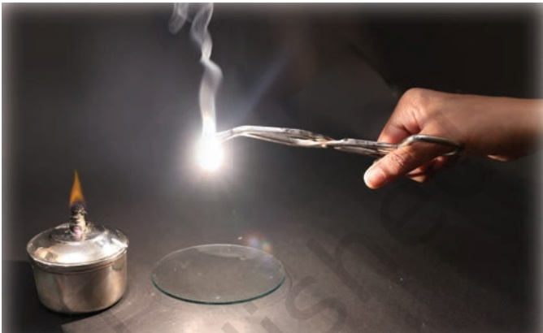
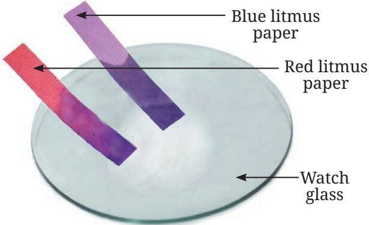

## 4.3 Effect of Air and Water on Other Metals

**Activity 4.6: Let us investigate (demonstration activity)**

The teacher may demonstrate this activity.

**Caution** — It is advisable for students to wear protective eyeglasses

and keep safe distance.

Take a magnesium ribbon about 3 – 4 centimetres long. Clean it by rubbing with a piece of sandpaper.

Hold it with a pair of tongs. Ignite the other end using a spirit lamp or a candle (Fig. 4.5).

Let the magnesium ribbon burn.

What do you observe?

You must have observed that magnesium ribbon burns with a dazzling white flame and changes into a white powder. Collect it on a watch glass. This powder is magnesium oxide. It is formed due to the reaction between magnesium and oxygen present in the air.

Fig. 4.5: Burning magnesium ribbon

Add a few drops of warm water to this white powder, stir it well, and check its nature.

Recall the chapter ‘Exploring Substances: Acidic, Basic, and Neutral’. Find out whether the solution of magnesium oxide is acidic or basic or neutral in nature. You can use any acid-base indicator.

What effect does this solution have on blue and red litmus papers?

You would observe that it changes the colour of red litmus paper to blue (Fig. 4.6); hence, it is basic in nature. Generally, oxides of metals are basic in nature.

We will discuss this burning of magnesium ribbon further in the chapter ‘Changes Around Us: Physical and Chemical’.

Fig. 4.6: Testing the nature of magnesium oxide