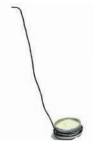
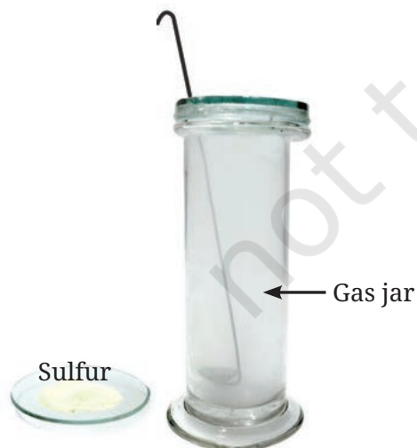
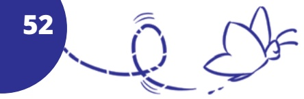

Fig. 4.7(a): Deflagrating spoon

Do you know that sodium is a metal which is stored in kerosene because it reacts vigorously with oxygen and water. A lot of heat is generated in the reaction. Storing sodium in kerosene prevents its exposure to moisture and air. Can you predict the nature of its oxide?

Let us now discuss some substances that do not behave like metals.

## 4.4 Substances that Behave Differently from Metals in Air and Water

**Activity 4.7: Let us experiment (demonstration activity)**

The teacher may demonstrate this activity.

**Caution**— This activity must be performed in a fume hood or well-ventilated area. Burning sulfur produces gases, which can be harmful if inhaled.

Fig. 4.7(b): Improvised deflagrating spoon

Take a small amount of powdered sulfur in a deflagrating spoon (it is a long-handled metal spoon used in experiments to safely heat and burn substances Fig. 4.7a). If a deflagrating spoon is not available, you may take a metallic cap of any bottle, wrap a metallic wire around it and give it the shape as shown in Fig. 4.7b.

Heat it on a flame, and as soon as the sulfur starts burning, introduce the deflagrating spoon into a gas jar or glass tumbler (Fig. 4.7c). Cover the gas jar or glass tumbler with a lid to ensure that the gas produced does not escape.

Fig. 4.7(c): Burning of sulfur

Remove the lid after 3 – 4 minutes and take out the deflagrating spoon. Add a small quantity of water into the gas jar, quickly place the lid back and shake it so that the gas dissolves.

Again, recall the chapter ‘Exploring Substances: Acidic, Basic, and Neutral’. Using an acid-base indicator, check whether the solution obtained after the addition of water to the gas jar is acidic or basic or neutral.

What do you observe?

