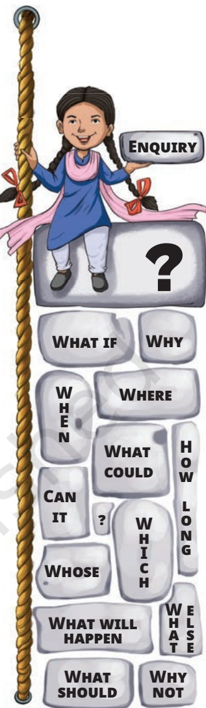

## Let Us Enhance Our Learning

1. Which metal is commonly used to make food packaging materials as it is cheaper, and its thin sheets can be folded easily into any shape? (i) Aluminium (ii) Copper (iii) Iron (iv) Gold

2. Which of the following metal catches fire when it comes in contact with water? (i) Copper (ii) Aluminium (iii) Zinc (iv) Sodium

3. State with reason(s) whether the following statements are True [T] or False [F].

(i) Aluminium and copper are examples of non-metals used for making utensils and statues. [ ]

(ii) Metals form oxides when combined with oxygen, the solution of which turns blue litmus paper to red. [ ]

(iii) Oxygen is a non-metal essential for respiration. [ ]

(iv) Copper vessels are used for boiling water because they are good conductors of electricity. [ ]

4. Why are only a few metals suitable for making jewellery?

5. Match the uses of metals and non-metals given in Column  I with the jumbled names of metals and non-metals given in Column II.

<table><tr><td>Column I</td><td rowspan=2>Column II(a) ENXYGO</td></tr><tr><td>(i) Used in electrical wiring</td></tr><tr><td>(ii) Most malleable and ductile</td><td>(b) NECOHIRL</td></tr><tr><td>(iii) Living organisms cannot survive without it.</td><td>(c) PEPORC</td></tr><tr><td rowspan=2>(iv) Plants  grow healthy when fertiliserscontaining it are added to the soil.(v) Used in water purification</td><td>(d) TENGOINR</td></tr><tr><td>(e) OGDL</td></tr></table>

6. What happens when oxygen reacts with magnesium and sulfur. What are the main differences in the nature of products formed?