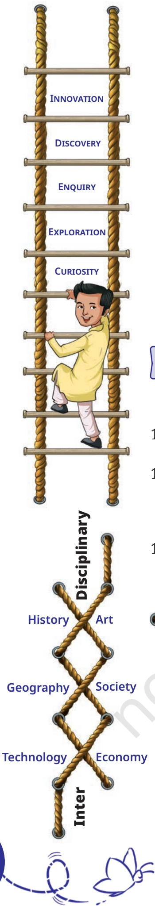
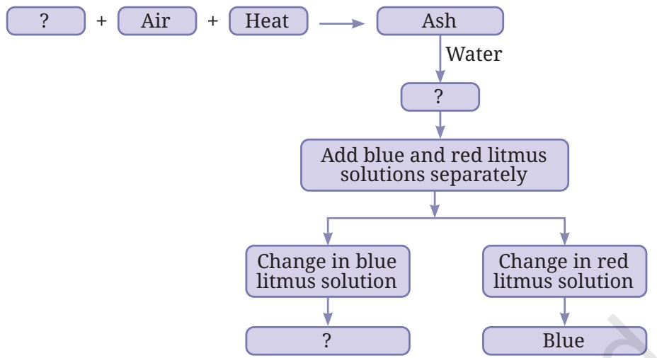
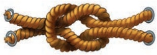

7. Complete the following flow chart:

8. You are provided with the following materials. Discuss which material would be your choice to make a pan that is most suitable for boiling water and why?

Iron copper sulfur coal plastic wood cardboard

9. You are provided with three iron nails, each dipped in oil, water and vinegar. Which iron nail will not rust, and why?

10. How do the different properties of metals and non-metals determine their uses in everyday life?

11. One of the methods of protecting iron from getting rusted is to put a thin coating of zinc metal over it. Since sulfur does not react with water, can it be used for this purpose? Justify your answer.

12. An ironsmith heats iron before making tools. Why is heating necessary in this process?

## Exploratory Projects

Dhokra, Bidriware, Pembarthi, and Kamrupi are some of India’s famous metal art styles. Find out the states where these artworks are made. Also, make a collage of their photographs.

On a map of India, mark the states where iron, gold, aluminium and other metals are found.

Explore the metals and non-metals found in smartphones and find out how they help the phone work properly.

Organise a classroom debate on whether the use of metals for comfort and luxury should be increased or decreased.

