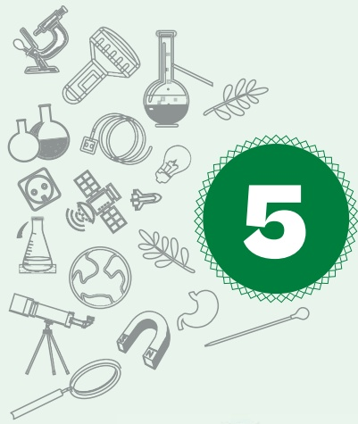
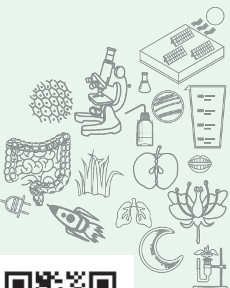
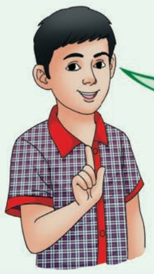
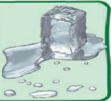
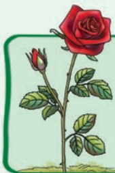
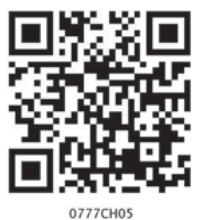
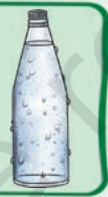
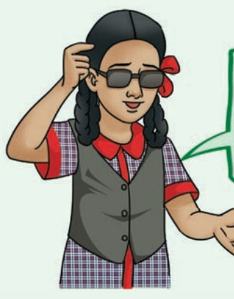
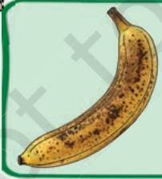
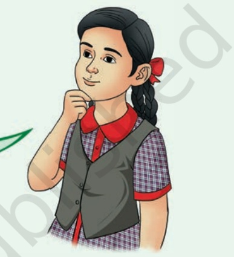

# Changes Around Us: Physical and Chemical

I placed a cube of ice here half an hour ago. It has now become water!

A bud that I saw yesterday on this rose plant has become a flower today.

The bottle containing cold water is not cold anymore.

0777CH05

Yesterday, I saw some brown spots on a banana, but today it has more brown spots and a strong smell.

These students are describing some changes. What kinds of changes are they talking about?