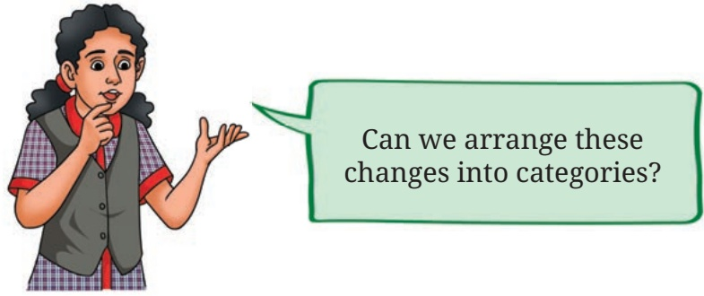

## Activity 5.1: Let us think and refl ect

You might have **observed** various changes happening around you. Some of them are listed in Table 5.1, you may notice that something is changing in each case. Take a moment to **reflect** on the changes in each case. **Record** your observations in Table 5.1.

Table 5.1: Some changes observed around us

| S.No. | Change Observation(s) |
| --- | --- |
| 1. | Melting ice cubes |
| 2. | Chopping vegetables |
| 3. | Boiling water |
| 4. | Making popcorn from corn |
| 5. | Cutting a piece of paper |
| 6. | Adding beetroot extract to water |
| 7. | Burning wood |
| 8. | Drying wet clothes |
| 9. | Making small balls of dough |
| 10. | Rolling small balls of dough into chapatis |
| 11. | Any other |

You might have noticed that these changes could be in the size, shape, smell, or other property of the substance or object. Can you think of some other changes that happen in your surroundings? Make a list of those changes too.

We observe the changes occurring around us with the help of our senses of sight, smell, touch, hearing, and taste.

Let us try to answer this question.