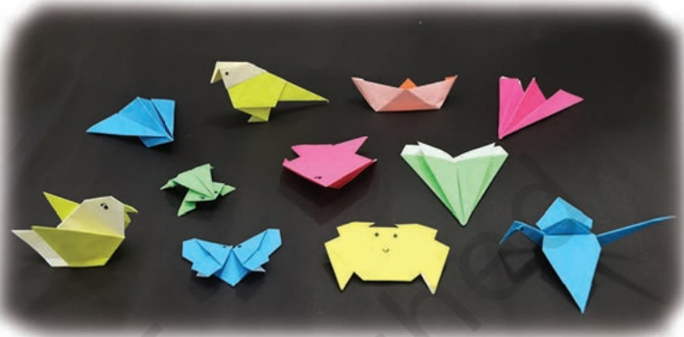

# 5.1 A Substance May Change in Appearance but Remain the Same!

## Activity 5.2: Let us create and discuss

## A. Creating some objects with paper

Take a few sheets of paper and fold them to create new objects (Fig. 5.1).

Do you get the same paper back when you unfold these objects?

## B. Playing with a balloon

Take a balloon and inflate it. Now, loosen your grip and let the air escape out.

Fig. 5.1: Objects made from paper

Do you get the uninflated balloon back?

Take another balloon; inflate it and grip the opening tightly. Now, prick it with a pin.

**Caution** — Be careful while using a pin.

What happens? Will you be able to get the uninflated balloon back?

## C. Crushing a piece of chalk

Crush a small piece of chalk into powder.

Can you get the chalk piece back from the powder?

Is there any similarity in the changes listed in A, B, and C?

During all these changes, materials, such as the paper, the rubber sheet of the balloon, and the chalk, remained the same, though their appearances (shape or size) may have changed. You may also recall from the Grade 6 Science textbook Curiosity that water can exist in different states (solid, liquid, and gas), and can change from one state to another.

In all these cases, although we observe a change in the appearance, no new substance is formed. Such changes in which only physical properties like shape, size, and state of substances change are called **physical changes**.

Let us **explore** a different type of change.