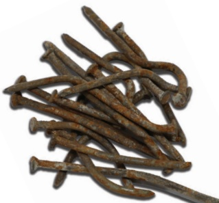
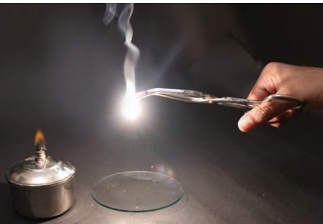
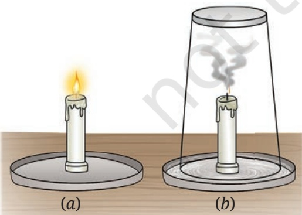

# 5.3 Some Other Processes Involving Chemical Changes

## 5.3.1 Rusting

In the rusting of iron, which you studied in the chapter ‘The World of Metals and Non-metals’, a new brown-coloured substance called rust is formed. Thus, rusting is also a chemical change because it involves the formation of a new substance, iron oxide (Fig. 5.4).

Fig. 5.4: Rusted iron nails

Fig. 5.5: Burning magnesium ribbon

## 5.3.2 Combustion

Let us recall the burning of a magnesium ribbon (Fig. 5.5) learnt in the chapter ‘The World of Metals and Non-metals’. Can you **predict** if this is a physical or a chemical change?

When the magnesium ribbon is burnt, a new substance, magnesium oxide, is formed. So, the burning of magnesium ribbon also involves a chemical change. We observed that heat and light are also produced along with the formation of a new substance in this reaction.

The burning of magnesium ribbon can be represented as— Magnesium + Oxygen Magnesium oxide + Heat + Light (Ribbon) (Air) (White powder)

A chemical reaction in which a substance reacts with oxygen and produces heat and/or light is called **combustion**. Substances that undergo combustion reactions are called **combustible substances**. For example, wood, paper, cotton, kerosene, etc., are combustible substances.

Fig. 5.6: Candle (a) burning (b) covered with a glass tumbler

Let us find out whether the presence of oxygen is essential for combustion.

## Activity 5.5: Let us investigate

Place two identical candles on two separate petri dishes and light them.

Cover one of these with a glass tumbler, as shown in Fig. 5.6.

What happens to the candle flames in the two cases?