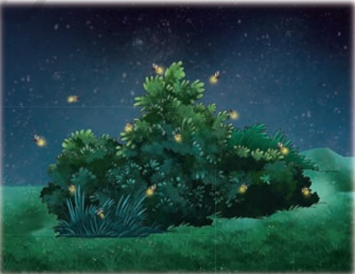

We observe that the candle that was not covered (Fig. 5.6a) continues to burn, whereas the candle that was covered with a glass tumbler (Fig. 5.6b) stops burning after some time. Why does this happen?

Since the candle covered by the glass tumbler does not have a continuous supply of air, the flame gets extinguished soon. The component of air that supports combustion is oxygen. This can be confirmed by the presence of carbon dioxide in the glass tumbler inverted on the candle. How can you test the presence of carbon dioxide gas?

You can test the carbon dioxide gas by adding a small amount of lime water in the petri dish. You will notice that it turns milky. This carbon dioxide was formed by the carbon from the wax and the oxygen from the air. In other words, oxygen is required for combustion.

## SCIENCE AND SOCIETY

If a person’s clothes catch fire, what is the best way to extinguish the fire?

Wrap a blanket or cloth around the person. This cuts off the supply of air, and the fire gets extinguished.

**Caution** — Synthetic blanket or cloth should never be used to put out a fire, as these can melt and stick to the skin.

## FASCINATING FACTS

**Nature’s wonders:** You might have You might have seen some insects emitting light inseen some insects emitting light in a garden or a field in late evenings.a garden or a field in late evenings. These insects are called fireflies, andThese insects are called fireflies, and their light is produced by a chemicaltheir light is produced by a chemical change. This type of light productionchange. This type of light production (without heat) in living organisms is(without heat) in living organisms is called bioluminescence.

FirefliesFireflies

## Is the Presence of Air Enough for Combustion?

We learnt above that combustible substances and oxygen are necessary for combustion. We also know that paper is a combustible substance, but we can keep it in the air for any length of time without it catching fire. What else is needed to start combustion?

Let us learn about this.