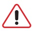
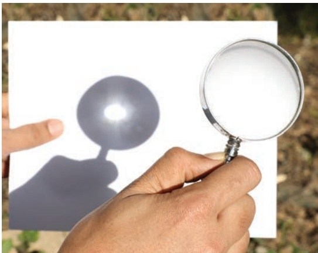
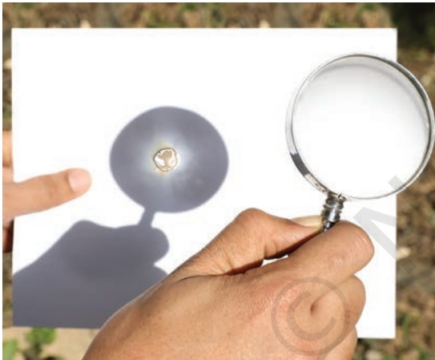
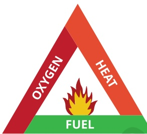

## Activity 5.6: Let us investigate

**Caution** — Perform this activity under the supervision of your teacher or an adult.

Fig. 5.7(a): Focusing the sunrays using a magnifying glass

Fig. 5.7(b): Paper catching fire

Hold a piece of paper with a pair of tongs and bring a lighted matchstick to it. It quickly catches fire. Do we say that we need a fire to start the burning process?

Take another piece of paper. Using a magnifying glass, focus the sunrays to make the smallest and brightest spot on the paper, as shown in the Fig. 5.7a. Hold it there for some time.

What do you observe?

We observe that the paper starts to emit smoke, and then catches fire (Fig. 5.7b). Thus, we find that a substance can burn even without fire. How do we explain this change?

Focusing sunrays on the paper heats it. The temperature of the paper increases with time. After some time, the paper becomes so hot that it starts burning. This minimum temperature at which a substance catches fire is called its **ignition temperature**. Since the temperature of the lighted matchstick was already higher than the ignition temperature of the paper, it caught fire almost immediately.

Fig. 5.8: Fire triangle

So, we can **conclude** that for the combustion process to occur, there are three requirements (Fig. 5.8) —

(ii) Oxygen

(i) A combustible substance, also called ‘fuel’

(iii) Heat that allows the fuel to reach its ignition temperature.

## 5.4 Can Physical and Chemical Changes Occur in the Same Process?

What changes take place when a candle is lit? Let us explore!