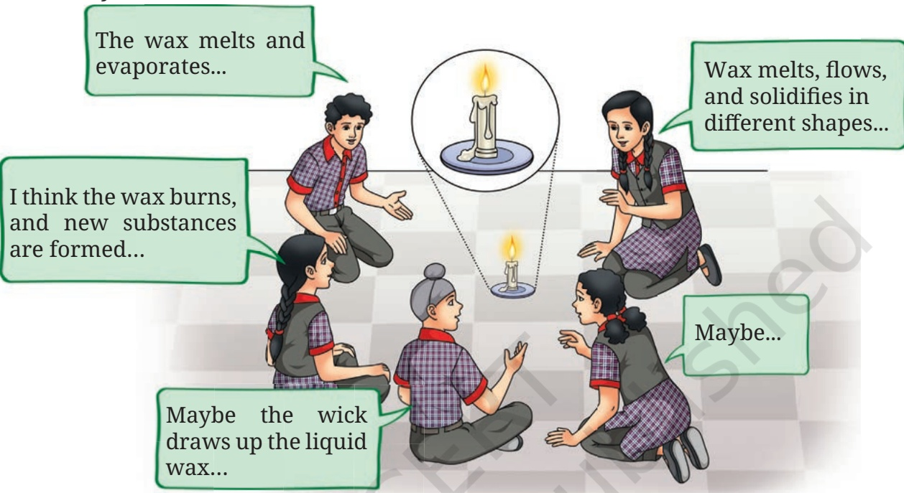
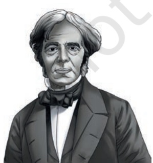
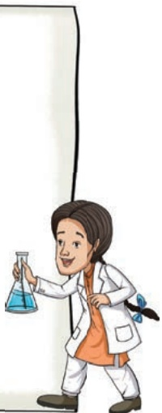

## Activity 5.7: Think, pair, and share

Look at the Fig. 5.9. **Analyse** what students are discussing about the burning candle.

What do you think?

Fig. 5.9: What changes occur when a candle burns?

The wax of the candle melts, is carried up the wick, and evaporates due to the heat of the flame. The vapour of wax burns to produce a flame. The melting of wax, its solidification, and evaporation are physical changes. The burning of vapour on the other hand, is a chemical change. This shows that the burning of a candle involves both physical and chemical changes.

## KNOW A SCIENTIST

The candle you just observed has long been an object of curiosity for several scientists including Michael Faraday, who made significant contributions to several areas of science. In the nineteenth century, Faraday delivered a series of lectures called Chemical History of a Candle. Faraday believed that the candle was the perfect object to introduce scientific study. Through it, he discussed differences between various physical and chemical processes like melting, vapourisation, and combustion.

