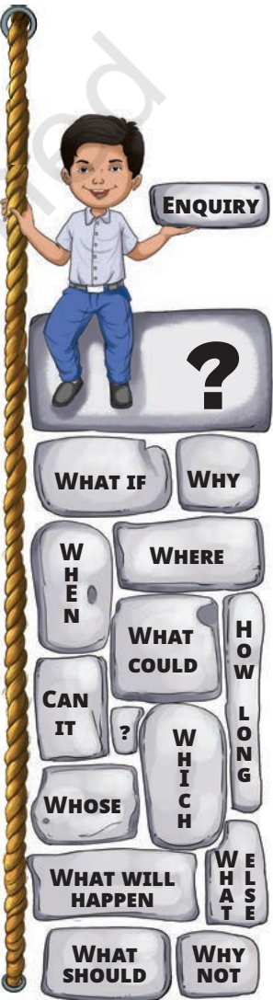

## Let Us Enhance Our Learning

1. Which of the following statements are the characteristics of a physical change?

(i) The state of the substance may or may not change.

(ii) A substance with different properties is formed.

(iii) No new substance is formed.

(iv) The substance undergoes a chemical reaction. (a) (i) and (ii) (b) (ii) and (iii) (c) (i) and (iii) (d) (iii) and (iv)

2. Predict which of the following changes can be reversed and which cannot be reversed. If you are not sure, you may write that down. Why are you not sure about these? (i) Stitching cloth to a shirt (ii) Twisting of straight string (iii) Making idlis from a batter (iv) Dissolving sugar in water (v) Drawing water from a well (vi) Ripening of fruits (vii) Boiling water in an open pan (viii) Rolling up a mat (ix) Grinding wheat grains to flour (x) Forming of soil from rocks

3. State whether the following statements are True or False. In case a statement is False, write the correct statement.

(i) Melting of wax is necessary for burning a candle. (True/False)

(ii) Collecting water vapour by condensing involves a chemical change. (True/False)

(iii) The process of converting leaves into compost is a chemical change. (True/False)

(iv) Mixing baking soda with lemon juice is a chemical change. (True/False)