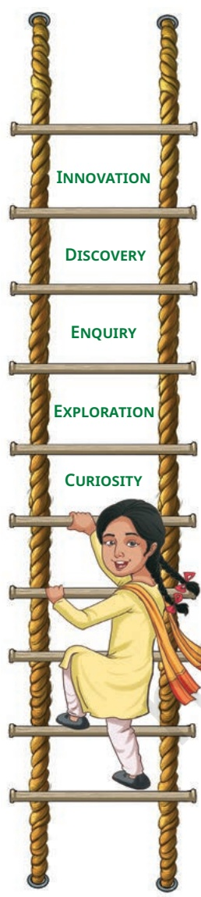
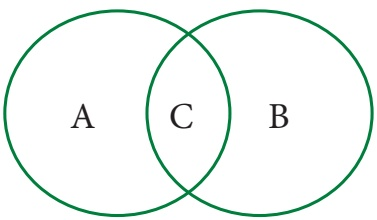

4. Fill in the blanks in the following statements:

(i) Nalini observed that the handle of her cycle has got brown deposits. The brown deposits are due to and this is a change.

(ii) Folding a handkerchief is a change and can be

(iii) A chemical process in which a substance reacts with oxygen with evolution of heat is called \_, and this is a change.

(iv) Magnesium, when burnt in air, produces a substance called The substance formed is in nature. Burning of magnesium is a change.

5. Are the changes of water to ice and water to steam, physical or chemical? Explain.

6. Is curdling of milk a physical or chemical change? Justify your statement.

7. Natural factors, such as wind, rain, etc., help in the formation of soil from rocks. Is this change physical or chemical and why?

8. Read the following story titled ‘Eco-friendly Prithvi’, and tick the most appropriate option(s) given in the brackets. Provide a suitable title of your choice for the story.

Prithvi is preparing a meal in the kitchen. He chops vegetables, peels potatoes, and cuts fruits (physical changes/chemical changes). He collects the seeds, fruits, and vegetable peels into a clay pot (physical change/chemical change). The fruits, vegetable peels, and other materials begin to decompose due to the action of bacteria and fungi, forming compost (physical change/chemical change). He decides to plant seeds in the compost and water them regularly. After a few days, he notices that the seeds begin to germinate and small plants start to grow, eventually blooming into colourful flowers (physical change/chemical change). His efforts are appreciated by all his family members.

9. Some changes are given here. Write physical changes in the area marked ‘A’ and chemical changes in the area marked ‘B’. Enter the changes which are both physical and chemical in the area marked ‘C’.

