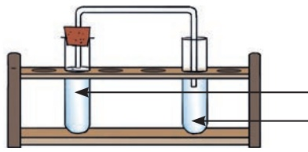
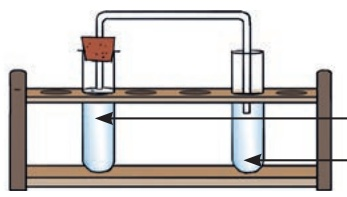
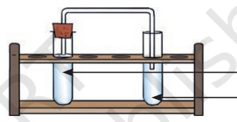
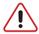
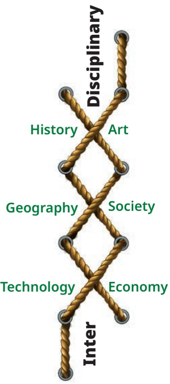

Process of burning a candle; Tearing of paper; Rusting; Curdling of milk; Ripening of fruits; Melting of ice; Folding of clothes; Burning of magnesium and Mixing baking soda with vinegar.

10. The experiments shown in Fig. 5.11a, b, c, and d were performed. Find out in which case(s) did lime water turn milky and why?

(a)

Vinegar and baking soda Lime water

(b)

Lemon juice and vinegar Lime water

(c)

Vinegar and common salt Lime water

(d)

Lemon juice and baking soda Lime water

Fig. 5.11

## Exploratory Projects

Write a message on a piece of paper using lemon juice as ink and let it dry. The message will become invisible. Now use a warm iron over the paper (or hold the paper over the flame of a candle, taking care that it does not catch fire). The invisible letters turn dark brown as the paper gets warm. Can any of these changes be reversed?

**Caution** — Perform this activity under the supervision of an adult.

We hear a lot of news about landslides and breaking of rocks in hilly regions these days, causing a lot of damage to life and property. Discuss what steps we can take to reduce landslides and rock erosion.

Observe the activities going on in the kitchen and note any changes that can be reversed. Are these physical or chemical changes?

