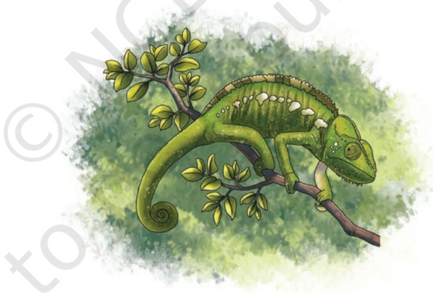
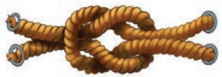

Yeast is added while baking bread to make it fluffy and soft. How does yeast work? Try and find out!

Take a small bottle, some sugar, fresh yeast, water, and a balloon. Make a sugar solution in the bottle by mixing two teaspoons of sugar and a small amount of water. Now add a spoonful of yeast and cover the mouth of the bottle with a balloon. Leave it undisturbed for about an hour.

What do you observe?

Carefully take off the balloon, holding its mouth tightly closed and attach it to another small bottle containing freshly prepared lime water. Shake the bottle so that the contents of the balloon get mixed with lime water.

What do you observe?

What can you conclude from this experiment?

Identify all the changes occurring in the experiment and state which of them are physical and chemical changes.

Chameleons (Girgits) change colour to blend in with their surroundings and also when they are angry or sense danger (Fig. 5.12). Is this a change that can be reversed? Explore from the internet or from your school library.

Fig. 5.12: A chameleon

