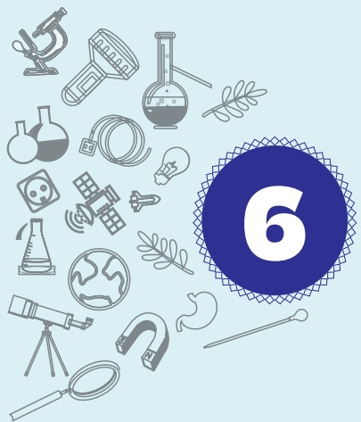
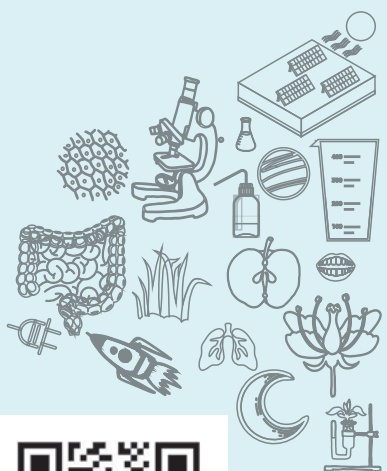
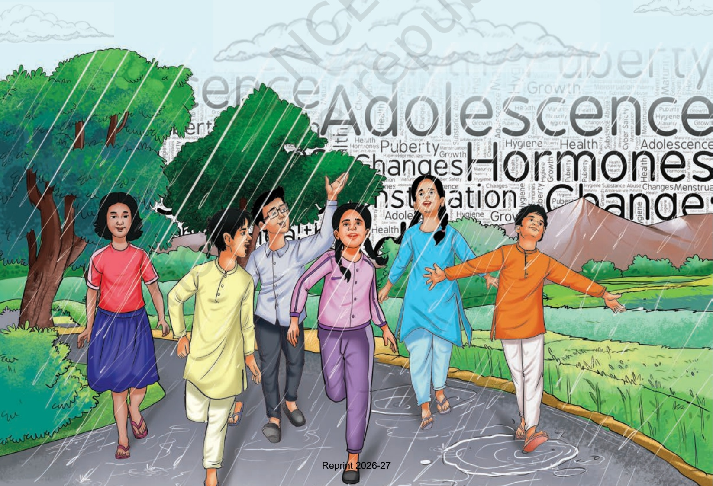

# Adolescence: A Stage of Growth and Change

The journey of a plant generally begins with the germination of a seed. With proper nourishment, the seed becomes a sapling and matures into a young plant. This journey is marked by some specific changes. Some of the visible changes are an increase in its height, the appearance of more leaves, and the development of flowers, fruits, and new seeds. From these seeds, new plants emerge.

0777CH06

It is quite unlikely that a seedling will develop the capabilities to produce its own seeds immediately after germination. It needs to grow and reach maturity to become capable of producing seeds. Similarly, animals also need to grow and reach maturity before they can reproduce. Some animals lay eggs that hatch into young ones, while others, like humans, directly give birth to young ones. In both cases, the young ones gradually grow in size and develop over time.

## Puberty HygieneHealthAdolescence anges ones sle nes ence ation aiene berty Substance Abuse ChangesMenstrua Health

