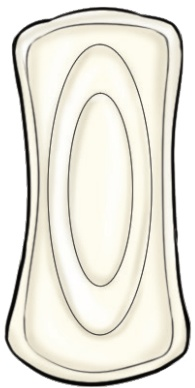

## Science and Society

Adolescents, especially girls, may sometimes suffer from blood-related health problem(s) because of a deficiency of iron or vitamin $\mathrm { B } _ { 1 2 }$ in the body.

™ Find out about such health problem(s).

™ How can we manage iron deficiency in our body?

™ Find out about government schemes aimed to prevent such deficiencies.

## Know a Scientist

Dorothy Hodgkin was a brilliant scientist who studied the structure of vitamin $\mathbf { B } _ { 1 2 ^ { \bullet } }$ In 1964, she became the third

woman to win the Nobel Prize in the field of chemistry. Did you know that vitamin $\mathtt { B _ { 1 2 } }$ is required for the proper functioning of the human body? Like most vitamins, it cannot be made in the human body and has to be obtained from the food we eat. Discuss the sources of vitamin $\mathtt { B _ { 1 2 } }$ with your teacher.

Fig. 6.1: Sanitary pad

## 6.4.2 Personal hygiene

Besides nutrition, personal hygiene is also crucially important during adolescence. Maintaining body hygiene, particularly in the armpits and the pubic region, may protect us from potential infections.

For girls, maintaining proper hygiene during menstruation is essential for both comfort and health. Menstrual hygiene can be maintained using items such as sanitary pads (Fig. 6.1) and reusable cloth pads designed for this purpose.

The government also attempts to provide these products free of charge or at a low price to improve the menstrual hygiene of girls and women. As a society, we should all make efforts to ensure the availability of necessary facilities in schools and public places to promote menstrual hygiene. Collectively, we should move forward, reducing any stigma around sanitary pads and helping in menstrual hygiene.

It is important to dispose of used sanitary pads properly by wrapping them in newspaper and disposing inside a dustbin. This is to ensure community health and environmental cleanliness. These days, biodegradable sanitary pads are also available that are environment-friendly.

