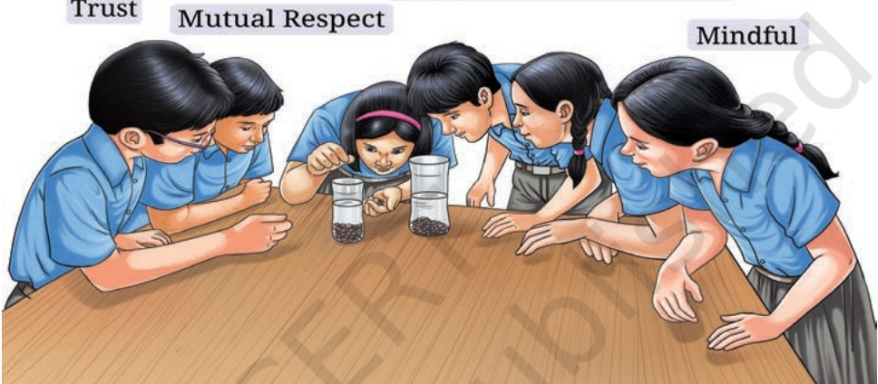
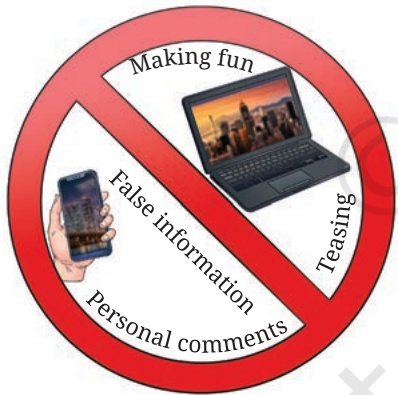
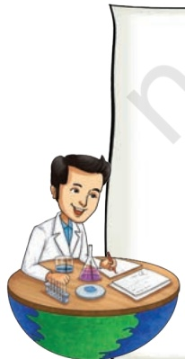

## 6.4.4 Balanced social life

We all live in a society and interact with each other in our day-to-day life. We should be polite and respectful towards each other (Fig. 6.3). This helps create a favourable and safe environment.

Since adolescence is a stage of life marked by new experiences and emotions, we must be thoughtful and responsible while interacting with others—whether in person or through social media. This is the time adolescents may feel attracted to their peers, and mimic their behaviour. Today, they often interact with each other online.

Respectful Communication

Fig. 6.3: Collaborative learning in action

seal

a
星

Modern technologies have made online platforms available for all to obtain information, make connections, interact, and share information with each other. We should use these platforms responsibly for the collective well-being of all. Sometimes, we, knowingly or unknowingly, use social media platforms carelessly. Seeking guidance from elders and teachers can help use these platforms positively.

Fig. 6.4: Cyberbullying

## Science and Society

**Cyberbullying** involves the use of digital devices such as phones, computers, or online platforms to harass others by sending misleading messages, spreading false rumours, or sharing personal information without consent (Fig. 6.4). However, if someone tries to bully you, it is important not to feel scared or helpless. Rather, handle it wisely and seek help from parents and teachers.

Additionally, you should be cautious when uploading any picture online or sharing personal information with strangers.