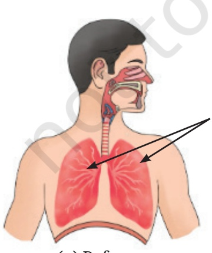
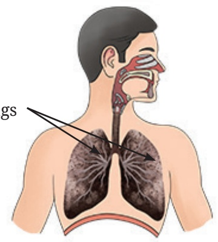

Lungs

## Activity 6.4: Let us spread awareness

Work in groups to **design** posters and pamphlets about various aspects of responsible social media behaviour and paste them at designated places in the school. Also, fill in Table 6.4 based on your collective observations.

Table 6.4: Dos and don’ts to be followed on social media

| Dos | Don'ts |
| --- | --- |
| Be respectful and kind. | Do not share personal photos with strangers/ virtual friends. |
| Think before posting. | ___________________ |
| Protect privacy. | ___________________ |

## 6.4.5 Avoiding harmful substances — learn to say NO

Some people, including your peers, may tempt, persuade, force or, create pressure on you to consume harmful substances such as tobacco, gutka, cigarettes, beedi, alcohol, or even life-threatening illegal drugs. Since adolescence is marked by curiosity and excitement, adolescents might get influenced by such people and try these substances.

These substances are not just harmful to physical and mental health but are also addictive. This means that once people start consuming them, they develop a strong urge to take them again and again. Over time, they start using them regularly. This is called **substance abuse**.

(a) Before

(b) After

Say ‘NO’ to addictive substances the first time and every time!

Fig. 6.5: Condition of the lungs before and after prolonged exposure to beedi/cigarette smoke