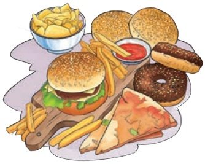
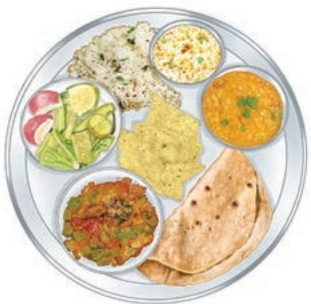

2. Which of the following food groups would be a better option for adolescents and why?

(i)

(ii)

3. Unscramble the underlined word in the following sentences:

(i) The discharge of blood in adolescent girls which generally occurs every 28–30 days is nstmnoiaretu.

(ii) The hoarseness in the voice of adolescent boys is due to enlarged iceov xob.

Curiosity | Textbook of Science | Grade 7

(iii) Secondary sexual characteristics are natural signs that the body is preparing for adulthood and mark the onset of urtypeb.

(iv) We should say NO to lahoclo and srugd as they are addictive.

4. Shalu told her friend, “Adolescence brings only physical changes, like growing taller or developing body hair.” Is she correct? What would you change in this description of adolescence?

5. During a discussion in the class, some of the students raised the following points. What questions would you ask them to check the correctness of these points?

(i) Adolescents do not need to worry about behavioural changes.

(ii) If someone tries a harmful substance once, they can stop anytime they want.

6. Adolescents sometimes experience mood swings. On some days, they feel very energetic and happy, while on other days, they may feel low. What other behavioural changes are associated with this age?

7. While using a toilet, Mohini noticed that used sanitary pads were scattered near the bin. She got upset and shared her feelings with her friends. They discussed the importance

