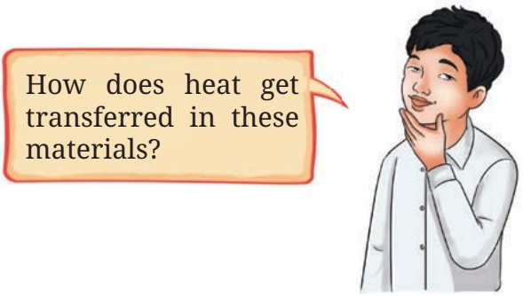
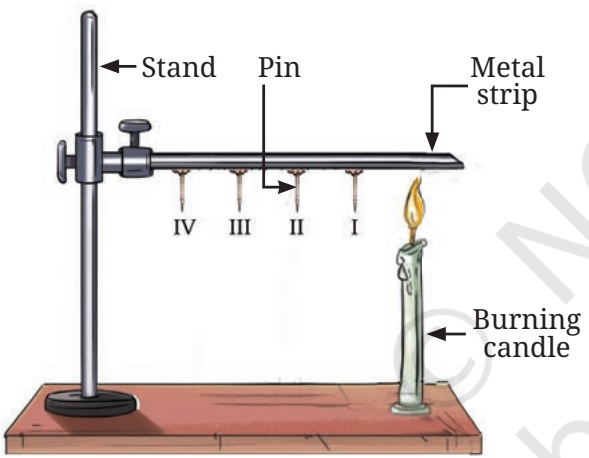
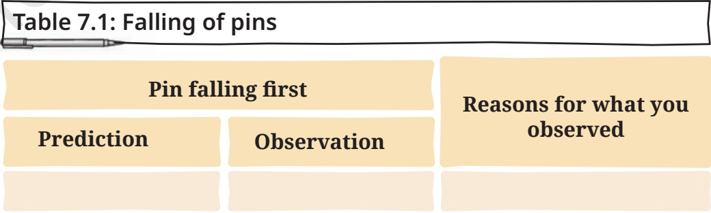

How does heat get transferred in these materials?

Let us **perform** an activity to learn why certain materials are good conductors of heat.

## 7.1 Conduction of Heat

**Activity 7.1: Let us experiment**

**Caution** — This activity should be carried out under the supervision of a teacher or an adult.

Fig. 7.1: Heat transfer in a metal strip

Take a strip of a metal, such as aluminium or iron, about 15 cm long.

Attach four pins to the strip with the help of wax such that they are arranged at nearly equal distances (about 2 cm apart), as shown in Fig. 7.1.

Secure the strip to a stand and label the pins as I, II, III, and IV, as shown in Fig. 7.1. (If a stand is not available, place the strip between two bricks for support.)

Heat the end of the strip that is away from the stand with a candle or a spirit lamp.

What will happen to the pins? Will they remain attached to the strip or will they fall?

**Predict** the order in which the pins will fall from the strip.

**Record** your observations in Table 7.1.

**Prediction**

**Pin falling first**

**Observation** **Reasons for what you observed**