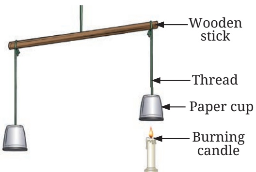
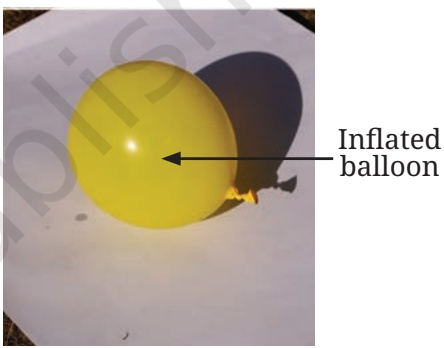
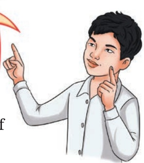

Now, adjust the positions of the cups, so that the stick is horizontal.

Place a burning candle below one of the cups (Fig. 7.3b).

Observe what happens to the cup.

Record your observations in Table 7.3 and think of probable reasons.

Fig. 7.3(b): Hot air rising up

## Table 7.3: Recording observations and probable reasons

Observation about the cups

Probable reasons for the observation

You observed that the cup under which the candle was placed, rises up (Fig. 7.3b). Why is it so? The air around the candle flame heats up. As the air in the cup warms up, it expands and occupies more space. As a result, it becomes lighter and rises up.

You can experience the expansion of air on heating it by placing a partially inflated balloon in the Sun (Fig. 7.4). After the air in the balloon gets heated, it expands and the balloon becomes larger.

Fig. 7.4: An inflated balloon in the Sun

You must have observed that when an incense stick (agarbatti) is burnt, smoke rises up. Smoke is a

mixture of hot gases and tiny solid particles that are released when something burns. As it is warmer than the surrounding air,

Let us find out how heat transfer takes place in liquids by performing the following activity.

**Activity 7.3: Let us find out** How does heat transfer take place in liquids? Do liquids also rise up when heated like air?

**Caution**— This activity should be carried out under the supervision of — This activity should be carried out under the supervision of a teacher or an adult.

Take a 500 mL beaker, half-filled with water as shown inTake a 500 mL beaker, half-filled with water as shown in Fig. 7.5a.

With the help of a straw, place a grain of potassium permanganate at the centre of the beaker’s base (Fig. 7.5a).

Place a candle right below the centre of the base of the beaker.