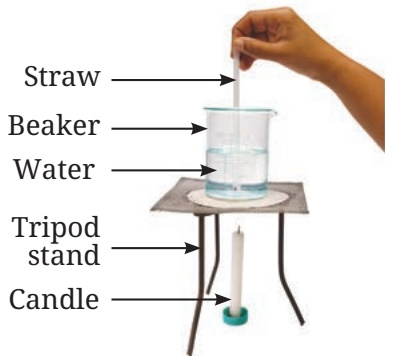
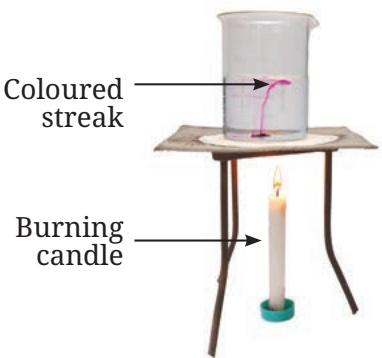
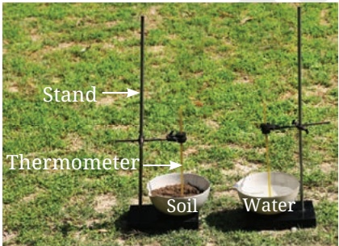

Fig. 7.5(a): Initial set-up for demonstration

Fig. 7.5(b): Demonstration of convection in heated water

Observe the movement of the coloured streak in the water.

As you supply heat, a streak of colour starts moving up and then coming down from the sides (Fig. 7.5b).

Why does the streak of coloured water go up in the middle and come down from the sides? The water at the bottom of the beaker gets heated up and becomes hot. It expands, becomes lighter, and rises. The water on the sides of the beaker is comparatively cooler and heavier, and comes down to take the place of the rising water. Then, this water gets heated and in turn also rises.

This cycle continues until the entire volume of water gets heated. In this case, the entire volume of water gets heated through the actual movement of water particles. This process of heat transfer is known as **convection**. It is because of convection that we see the movement of the coloured streak inside the beaker.

Thus, we can **conclude** that water, like air, gets heated up by the process of convection. Here, heat transfer takes place by the actual movement of particles of liquids and gases from one place to another.

## 7.2.1 Land and Sea Breeze

Palden shares his experience of visiting a beach in Kerala during winter vacation and says, “During the day, the sand or soil near the beach is hotter than the water in the sea. However, at night, the sand or soil is cooler than the water.” Pema replies, “Yes, different objects get heated and cooled differently.”

Let us check how land and water get heated and cooled by performing an activity.

**Activity 7.4: Let us investigate**

**Caution**— This activity should be carried out on a clear, sunny day under the supervision of a teacher or an adult.

Fig. 7.6: Measurement of the temperature of soil and water

Take two identical bowls as shown in Fig. 7.6.

Fill one bowl halfway with soil and the other bowl halfway with water.

Fix a laboratory thermometer in each bowl as shown in Fig. 7.6. Make sure that the bulbs of the thermometer are immersed in soil and water, and do not touch the bottoms or the sides of the bowls.

Place the set-up in sunlight.