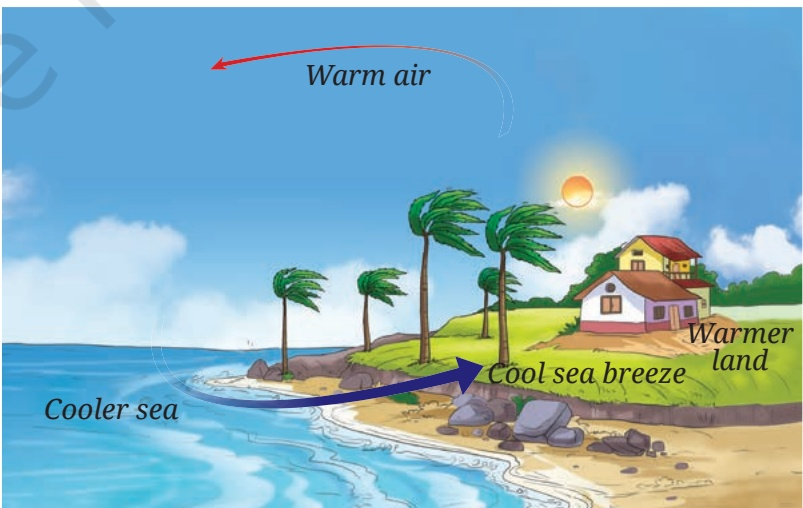

Measure the temperature of soil and water every 5 minutes and record the data in Table 7.4.

Table 7.4: Temperature of soil and water when heated

| S.No. | Time(min) | Temperatureofsoil (°C) | Temperature ofwater (°C) |
| --- | --- | --- | --- |
|  | 0 |  |  |
| 2. | 5 |  |  |
| 3. | 10 |  |  |
| 4. | 15 |  |  |
| 5. | 20 |  |  |

Study the rise in temperature of soil and water.

Did the temperature rise by the same amount for both the soil and the water at the same time?

If not, which one got heated faster?

How much was the rise in temperature of the soil and the water in 20 minutes?

After 20 minutes, you will find that the temperature of the soil rises more than that of the water. This indicates that the soil heats up faster than water.

Does the soil also cool faster than water? After letting the soil and water get heated, bring the set-up indoors and let it cool for

20 minutes. You will observe that the soil cools faster than water, just as it gets heated faster.

People living in coastal areas experience an interesting phenomenon caused by the heating and cooling of land and water at different rates. As the land gets heated faster than water during the day, it causes warm air above the land to rise. This causes cooler air to move from the sea towards the land. This movement of cooler air from the sea to the land is called **sea breeze**

Fig. 7.7(a): Sea breeze

(Fig. 7.7a). Hence, in hot places, sea breeze relieves people from the heat. That is why, windows of the houses in coastal areas are placed facing the sea.