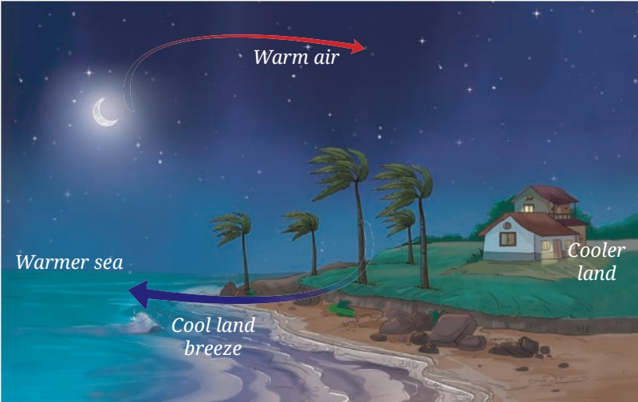
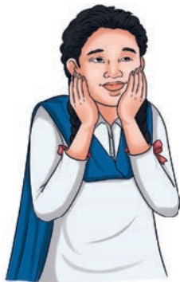
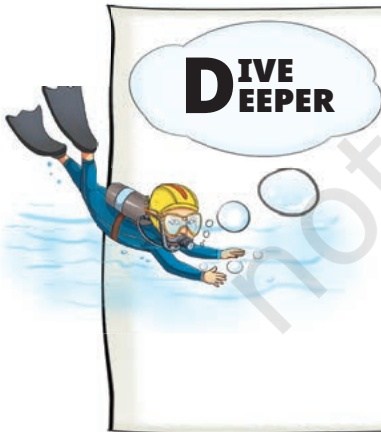

Fig. 7.7(b): Land breeze

At night, the process reverses. In the absence of sunlight, land cools down faster than the water in the sea. As a result, the air above the sea is warmer and rises up. Cooler air from the land then moves towards the sea, creating a **land breeze** (Fig. 7.7b).

Thus, people living near the seashore experience that the direction of the wind reverses in the day and night.

## 7.3 Radiation

Do you remember when Pema and Palden were sitting around the fireplace? They felt warm.

I wonder how heat from the fire reaches us?

Their grandfather tells them that the heat transfer, in this case, takes place directly from the fire (hot object) to us by a process known as **radiation**. The heat of the Sun reaches us through this process. Heat transfer by radiation does not require any medium.

All objects radiate heat. You must have observed that a hot utensil kept away from the flame cools down after some time. What is the reason for it? The hot utensil cools down by radiating heat to its surroundings.

## D IVE EEPER

## Why is it more comfortable to wear white or light-colouredWhy is it more comfortable to wear white or light-coloured clothes during summers and dark-coloured clothes duringclothes during summers and dark-coloured clothes during winters?winters?

Light-coloured clothes reflect most of the heat that falls onLight-coloured clothes reflect most of the heat that falls on them, and therefore, we feel more comfortable wearingthem, and therefore, we feel more comfortable wearing them during summers. Dark surfaces, on the other hand,them during summers. Dark surfaces, on the other hand, absorb more heat, and therefore, we feel more comfortableabsorb more heat, and therefore, we feel more comfortable with dark-coloured clothes during winters.