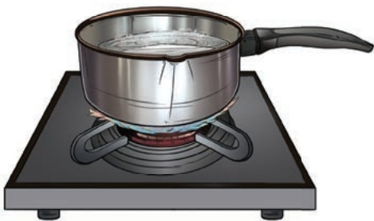
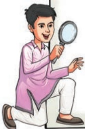
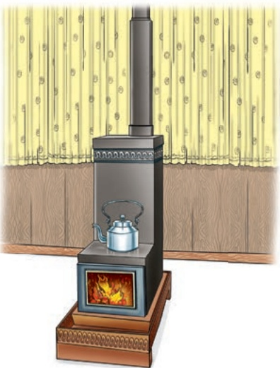

There are many examples in our daily life, where we can observe conduction, convection, and radiation happening together.

Consider the case of water being heated up, as shown in Fig. 7.8. Let us **identify** the various ways in which the pan and the water get heated up, as well as the warmth we feel around the flame and the hot pan. Heat is transferred from the flame to the utensil by conduction. Subsequently, water in the utensil gets heated up by convection. The warmth that we feel around the flame and the hot utensil is due to radiation.

Fig. 7.8: Heating water in a pan

## Let us wrap up!

From the activities, examples, and discussions so far, we find that there are three processes by which heat gets transferred. These are conduction, convection, and radiation.

In conduction, heating takes place when one particle receives heat, transfers heat to the next particle in contact, and so on. The particles themselves do not move away from their positions.

In convection, heat transfer takes place by the actual movement of particles.

Note that in conduction and convection, a medium must be present whose particles help in the transfer of heat.

In the case of radiation, heat travels from one place to another and no material medium is required for its transfer.

## FASCINATING FACTS

In the upper reaches of the HimalayanIn the upper reaches of the Himalayan region, a traditional room heater locallyregion, a traditional room heater locally known as bukhari is used to keep rooms is used to keep rooms warm during winters. It consists of an ironwarm during winters. It consists of an iron stove in which wood or charcoal is burnt.stove in which wood or charcoal is burnt. A long pipe attached to the upper part ofA long pipe attached to the upper part of the heater serves as a chimney, ventingthe heater serves as a chimney, venting out the smoke. Additionally, the bukharibukhari can be used for cooking, as its flat topcan be used for cooking, as its flat top provides a platform for placing utensils.provides a platform for placing utensils. All the three processes of heat transferAll the three processes of heat transfer are involved when this device is used forare involved when this device is used for cooking and warming up the room.

Bukhari