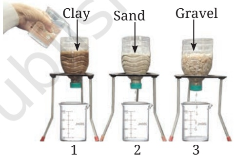

## KNOW A SCIENTISTKNOW A SCIENTIST

Varahamihira was an astronomer and mathematician of theVarahamihira was an astronomer and mathematician of the sixth century CE in Ujjaini (modern-day Ujjain), Madhya Pradesh.sixth century CE in Ujjaini In his work Brihatsamhita, he gave methods for predicting seasonalIn his work rainfall. His predictions of seasonal rainfalls were based on factors,rainfall. His predictions of seasonal rainfalls were based on factors, such as cloud formation, wind patterns, position of stars and thesuch as cloud formation, wind patterns, position of stars and the moon, and other natural phenomena.moon, and other natural phenomena.

You may have seen people drawing water from wells or handpumps. This is the water that has seeped into the ground.

Let us understand how water seeps through the surface of the earth by performing an activity.

How does water seep through the surface of the Earth?

## 7.4.1 Seepage of water beneath the Earth

## Activity 7.5: Let us investigate

Take three transparent, used plastic bottles of 1 L capacity.

Cut them in the middle and make a small hole in the cap of each bottle.

Keep them inverted and put some clay in one bottle, sand in the second, and gravel in the third, as shown in Fig. 7.10.

Fig. 7.10: An activity to compare the flow of water through clay, sand and gravel

Place three identical beakers below each bottle.

Add 200 mL of water to each bottle.

Predict the amount of water flowing out of each bottle.

Collect the water that flows through each bottle for 10 minutes.

Compare the amount of water that comes through each bottle.

Table 7.5: Seepage of water

<table><tr><td rowspan=3>Bottlesfilled with</td><td rowspan=2>Prediction</td><td></td></tr><tr><td>Observation</td></tr><tr><td>Seepage of water(very slow/slow/fast)</td><td>Seepage of water(very slow/slow/fast)</td></tr><tr><td>Bottle 1 (Clay)</td><td></td><td></td></tr><tr><td>Bottle 2 (Sand)</td><td></td><td></td></tr><tr><td>Bottle 3 (Gravel)</td><td></td><td></td></tr></table>