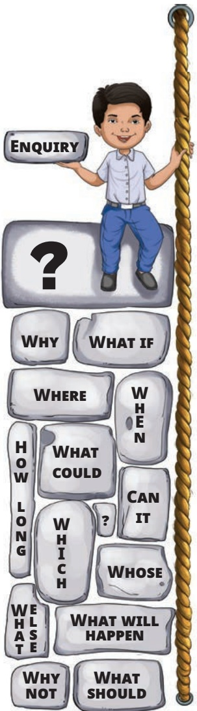
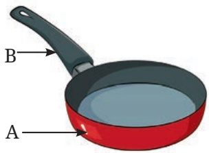
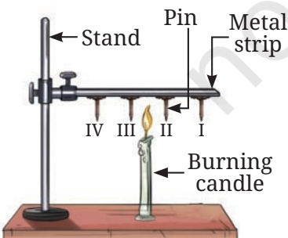

In convection, heat transfer takes place by the actual movement of particles. Land and sea breezes are examples of the process of convection.

Heat from the Sun reaches the Earth through radiation.

All objects exchange heat with their surroundings through the process of radiation.

Processes of conduction and convection require a medium for heat transfer but no medium is required for the radiation process.

The principles of heat transfer are utilised in designing houses and clothing.

The continuous movement of water — upward as water vapour and downward through precipitation, passing through soil, rocks and plants, and finally returning to water bodies, is called water cycle.

The process of surface water seeping through soil and rocks is called infiltration.

Groundwater is the water that seeps through and gets stored in the pore spaces of sediments and the openings in rocks beneath the surface.

The underground layers of sediments and rocks that store water in pore spaces are called aquifers.

## Let Us Enhance Our Learning

1. Choose the correct option in each case.

(i) Your father bought a saucepan made of two different materials, A and B, as shown in Fig. 7.14. The materials A and B have the following properties —

(a) Both A and B are good conductors of heat

Fig. 7.14: Saucepan

Fig. 7.15: Heat transfer set-up

(b) Both A and B are poor conductors of heat

(c) A is a good conductor and B is a poor conductor of heat

(d) A is a poor conductor and B is a good conductor of heat

(ii) Pins are stuck to a metal strip with wax and a burning candle is kept below the rod, as shown in Fig. 7.15. Which of the following will happen?

(a) All the pins will fall almost at the same time

(b) Pins I and II will fall earlier than pins III and IV

(c) Pins I and II will fall later than pins III and IV

(d) Pins II and III will fall almost at the same time

