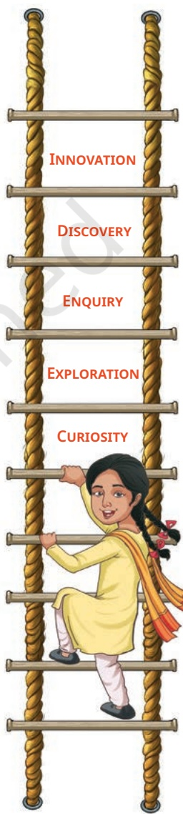
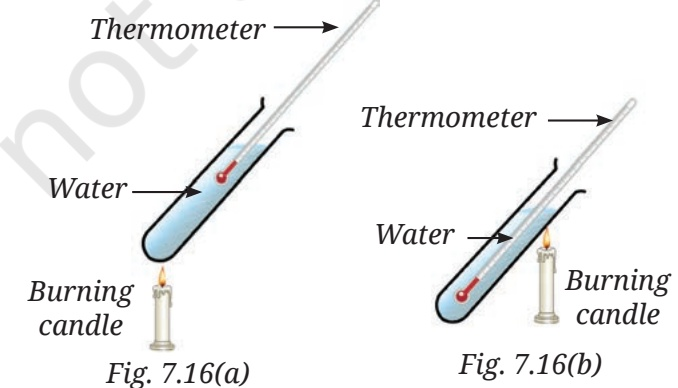

(iii) A smoke detector is a device that detects smoke and sounds an alarm. Suppose you are fitting a smoke detector in your room. The most suitable place for this device will be:

(a) Near the floor

(b) In the middle of a wall

(c) On the ceiling

(d) Anywhere in the room

2. A shopkeeper serves you cold lassi in a tumbler. By chance, the tumbler had a small leak. You were given another tumbler by the shopkeeper to put the leaky tumbler in it. Will this arrangement help to keep the lassi cold for a longer time? Explain.

3. State with reason(s) whether the following statements are True [T] or False [F].

(i) Heat transfer takes place in solids through convection. [ ]

(ii) Heat transfer through convection takes place by the actual movement of particles. [ ]

(iii) Areas with clay materials allow more seepage of water than those with sandy materials. [ ]

(iv) The movement of cooler air from land to sea is called land breeze. [ ]

4. Some ice cubes placed in a dish melt into water after sometime. Where do the ice cubes get heat for this transformation?

5. A burning incense stick is fixed, pointing downwards. In which direction would the smoke from the incense stick move? Show the movement of smoke with a diagram.

6. Two test tubes with water are heated by a candle flame as shown in Fig. 7.16. Which thermometers (Fig. 7.16a or Fig. 7.16b) will record a higher temperature? Explain.

Fig. 7.16: Two thermometers dipped in two test tubes