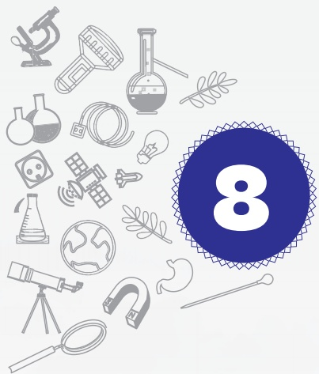
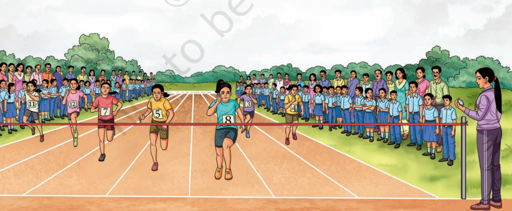

# Measurement of Time and Motion

Prerna and her younger sister are watching a sports channel on television. Prerna enjoys running and she has been declared the fastest runner among the girls in her district for winning the 100 metre sprint at an interschool competition held at the district level. She is now training to compete at the state level. She dreams of representing India at the international level in 100 metre sprint contests in future.

0777CH08

While watching the rerun of sprints at the Olympic games held in the past, Prerna is always amazed that the measurement of the time taken for the race is so advanced that they could identify the winner even when two sprinters seemed to cross the finish line almost together. However, in her school, the sports teacher only used a special kind of watch called a ‘stopwatch’ for timing the school races. She had noticed her mother wearing a watch on her wrist and her sister looking at her mobile phone when she needed to check the time. Her uncle used a Braille watch and had recently acquired a talking watch that announced the time at the touch of a button. There was also a large clock on the wall near the school entrance. Her thoughts turned to people in the ancient past, who did not have the modern gadgets we have today and she wondered…

