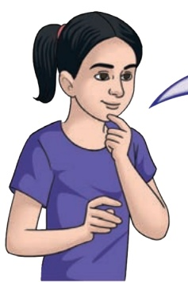
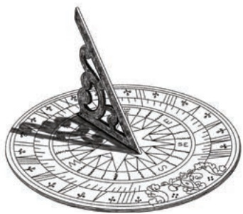
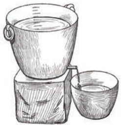
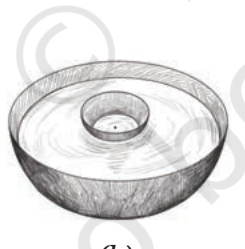
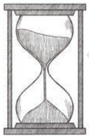
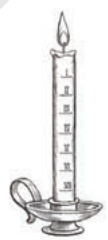
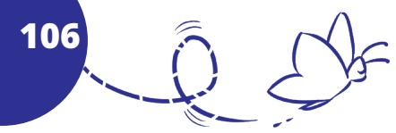

(b)

(a)

How was time measured when there were no clocks and watches?

## 8.1 Measurement of Time

Humans got interested in keeping track of time long ago. They started noticing that many events in nature repeat themselves after definite intervals of time. For example, the rising and setting of the Sun, the phases of the Moon and the changing seasons. They started using the cycles of these events for timekeeping. First, they devised calendars. A day was defined by the cycle of rising and setting of the Sun. Then began the quest to find ways of knowing the time of day.

Fig. 8.1: A sundial

Fig. 8.2: A water clock (a) Water flowing out-type (b) Floating bowl-type

So, they made many devices which helped them to measure smaller intervals of time within a day. Some of these were sundials, water clocks, hourglasses, and candle clocks.

In a sundial, time is determined with the changing position of the shadow of an object cast by the light of the Sun during the day (Fig. 8.1).

Fig. 8.3: An hourglass

Fig. 8.4: A candle clock

The water clocks used the flow of water out or into a vessel to measure time. In one type, water flowed out from a vessel which had markings for time (Fig. 8.2a). In the other type, there would be a bowl, with a fine hole at the bottom, which was floated on the surface of water (Fig. 8.2b). It gradually filled up in a fixed time and finally sank. Then, it was lifted up and floated again.

In an hourglass (Fig. 8.3), time was measured on the basis of the flow of sand from one bulb to another.

Candle clocks (Fig. 8.4) were candles with markings that indicated the passage of time when burned.

