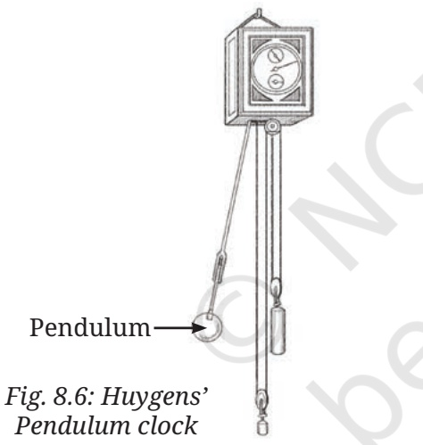

## FASCINATING FACTS

In ancient India, time was measured using both shadows and water clocks. The earliest reference to shadow-based time measurement appears in the Arthasastra by Kautilya (was composed and revised between the second century BCE – third century CE). An accurate expression for time in terms of the shadow of a vertical stick was given by Varahamihira around 530 CE. The water clock with water flowing out was described in the Arthasastra, Sardulakarnavadana, and some other texts (early CE centuries). These clocks were not very accurate because as water levels dropped, the flow rate decreased. This led to the development of the sinking bowl water clock (Fig. 8.2b), or Ghatika-yantra, first mentioned by Aryabhata, and then, first mentioned by Aryabhata, and then in several astronomical texts later. Time was measured constantlyin several astronomical texts later. Time was measured constantly with Ghatika-yantra at Buddhist monasteries, royal palaces, town at Buddhist monasteries, royal palaces, town squares, and each time the bowl sank, it was announced by drums,squares, and each time the bowl sank, it was announced by drums, conch shells, or striking a gong. Though the Ghatika-yantra was  was progressively replaced by pendulum clocks in the late nineteenthprogressively replaced by pendulum clocks in the late nineteenth century, it continued to be used at the religious places for rituals.

Fig. 8.6: Huygens’ Pendulum clock

As human civilisation advanced, and as people began to travel long distances, the measurement of time became very critical. This led to the development of increasingly better mechanical devices for the measurement of time, driven by weights, gears, and springs from the fourteenth century onwards. However, the invention of the pendulum clock in the seventeenth century marked a major breakthrough in mechanical timekeeping.

## KNOW A SCIENTIST

The pendulum clock was invented in 1656 and patented in 1657 by Christiaan Huygens (1629 –1695). He was inspired by the investigationsChristiaan Huygens (1629 –1695). He was inspired by the investigations of pendulums by Galileo Galilei (1564 –1642). It is said that once whileof pendulums by Galileo Galilei (1564 –1642). It is said that once while sitting in a church, Galileo’s attention was drawn to a lamp suspendedsitting in a church, Galileo’s attention was drawn to a lamp suspended from the ceiling, which was swinging back and forth. Using his pulsefrom the ceiling, which was swinging back and forth. Using his pulse to measure time, Galileo found that the lamp took the same time forto measure time, Galileo found that the lamp took the same time for each swing. After experimenting with different pendulums, Galileoeach swing. After experimenting with different pendulums, Galileo concluded that the time taken to complete one oscillation was alwaysconcluded that the time taken to complete one oscillation was always the same for a pendulum of a given length.the same for a pendulum of a given length.

