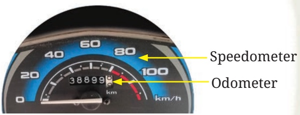
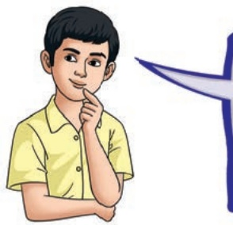
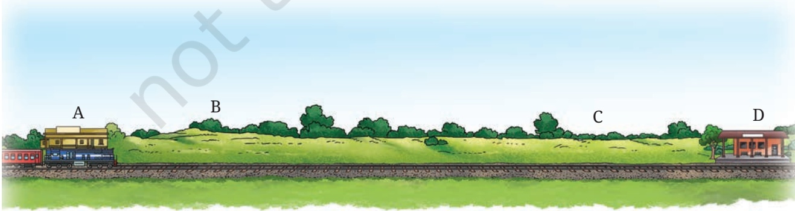

## SCIENCE AND SOCIETY

Vehicles such as scooters, motorbikes, cars, and buses have an instrument which measures and displays the vehicle’s speed in km/h. It is called a speedometer. Another instrument, known as an odometer, is also fitted in the vehicles that measures the distance travelled by the vehicle in kilometre.

Speedometer Odometer

I once watched a part of marathon on a straight road stretch. I noticed that some people seemed to be running at the same speed during that distance while some people would speed up or slow down. How were their motion different?

## 8.4 Uniform and Non-uniform Linear Motion

Do you remember learning about linear motion in the chapter ‘Measurement of Length and Motion’ in the Grade 6 Science textbook Curiosity? When an object moves along a straight line, its motion is called linear motion. Now, imagine a train on a track which is along a straight line between two adjacent railway stations. So, the motion of the train between these two stations is an example of linear motion (Fig. 8.11). The train starts from the first station A at a slow speed, then moves at a faster speed, then slows down and comes to a halt at the next station D. In between the two stations, for some distance (B to C), the train moves at a constant speed, that is, at an unchanging speed.

Fig. 8.11: A train on a straight track

