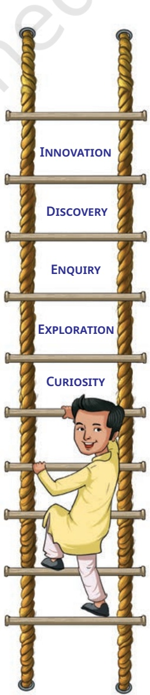

8. A car covers 60 km in the first hour, 70 km in the second hour, and 50 km in the third hour. Is the motion uniform? Justify your answer. Find the average speed of the car.

9. Which type of motion is more common in daily life— uniform or non-uniform? Provide three examples from your experience to support your answer.

10. Data for the motion of an object are given in the following table. State whether the speed of the object is uniform or non-uniform. Find the average speed.

| Time (s) | 0 | 10 | 20 | 30 | 40 | 50 | 60 | 70 | 80 | 90 | 100 |
| --- | --- | --- | --- | --- | --- | --- | --- | --- | --- | --- | --- |
| Distance (m) | 0 | 6 | 10 | 16 | 21 | 29 | 35 | 42 | 45 | 55 | 60 |

11. A vehicle moves along a straight line and covers a distance of 2 km. In the first 500 m, it moves with a speed of 10 m/s and in the next 500 m, it moves with a speed of 5 m/s. With what speed should it move the remaining distance so that the journey is complete in 200 s? What is the average speed of the vehicle for the entire journey?

## Exploratory Projects

Construct a floating bowl-type water clock. Experiment by using bowls of different sizes and making holes of different sizes in them so that the sinking time of the bowl can be close to 24 minutes.

Design an activity for measuring the pulse rate (number of times the pulse of a person beats in 1 minute) of your friends. Think of an activity where you can use your pulse to measure time and develop a story over that idea.

What might be the reasons for the slight differences in the time periods of a pendulum of a given length in different readings taken in Activity 8.2. Think of ways to control those and repeat the activity to check if the difference in readings is reduced.

Visit a playground with a few swings. Measure the time taken by a swing for 10 oscillations and calculate its time period. Repeat it a few times with children of different weights to find out if its time period is almost the same. Repeat this with swings of different lengths. Find out how the time period changes with increasing length of the swings. Is the swing also an example of a pendulum?

**INNOVATION**

**DISCOVERY**

**ENQUIRY**

**EXPLORATION**