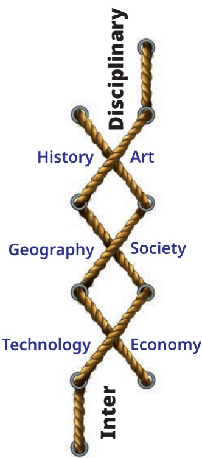

Gather the timings of the winners of the races — 100 m, 200 m, and 400 m for men and women in the last two Olympic games. Calculate and compare their speeds. In which event is the speed the fastest?

## FASCINATING FACTS

Time started when our Universe was created and will continue in the future. We cannot see or feel time but we can only measure its passage in terms of a time interval between events. These time intervals can be fractions of a second, or even days or months, or years or centuries. We can only say when an event occurred or for how long it lasted. Though we have learnt to measure time with increasing accuracy, and our lives are governed by watches and clocks, ‘What is time?’ continues to be a tricky question with no easy answer!

