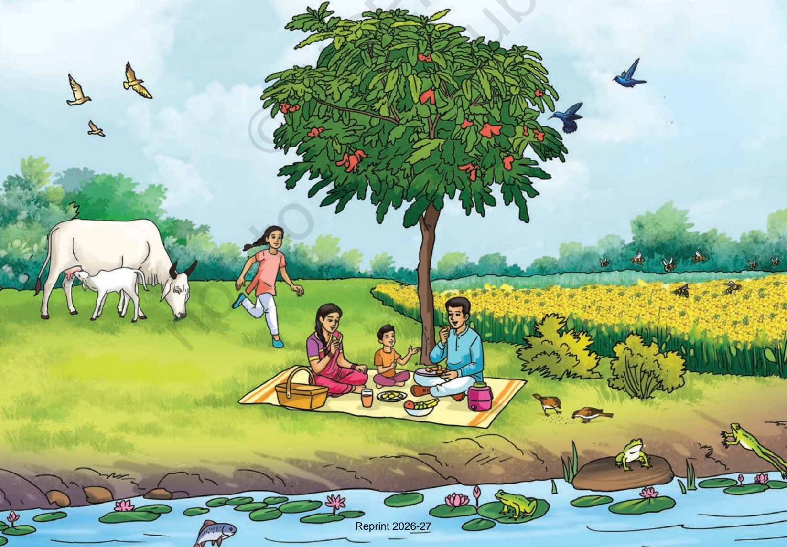

.

If your food is fully digested before you eat again, you won’t need medicine for pain. (Thirukkural 942)

In the Grade 6 Science textbook Curiosity, chapter ‘Living Creatures: Exploring their Characteristics’, we learnt about processes essential for survival of living beings like nutrition, respiration, excretion, and reproduction. These are collectively called life processes. In this chapter, we will learn about life processes such as nutrition and respiration in detail.

