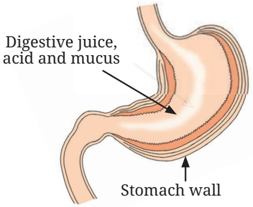
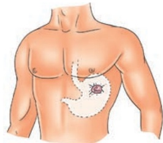
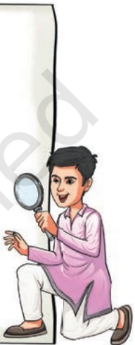
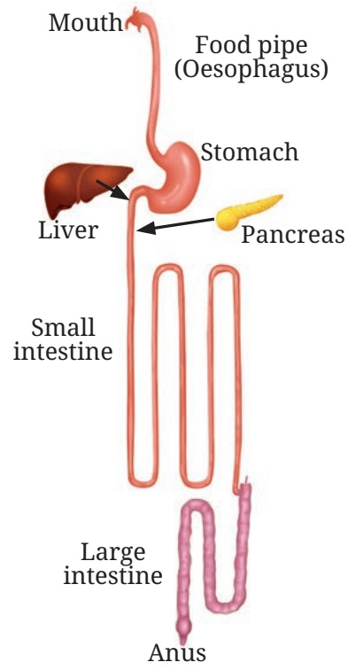

The digestive juice of the stomach breaks down proteins present in the food into simpler components.

The acid not only helps break down proteins but also kills many harmful bacteria. The mucus protects the stomach lining from the acid, preventing damage. In the stomach, the food is partially digested and transformed into a semi-liquid mass, preparing it for the next stage of digestion.

Fig. 9.3: Stomach

## FASCINATING FACTS

How did scientists learn about digestion in the human body?

Alexis St. Martin’s shotgun wound

The discovery of how the stomach works happened by chance. In 1822, a man named Alexis St. Martin was accidentally shot in the stomach. He was treated by a doctor, William Beaumont. However, his wound never fully healed, leaving a small permanent hole. This opening allowed Dr. Beaumont to observe digestion in the stomach as it happened. He conducted experiments on how different foods were broken down and studied how emotions affect digestion.

## Small Intestine

After its journey through the stomach, the partially digested food moves into the small intestine. Look at Fig. 9.4. It is a sketch of a stretched-out alimentary canal. Guess how long it is. You will be surprised that although it is called small intestine, it is almost 6 metres long—almost twice the height of your classroom! You will be surprised to know that the small intestine is the longest part of the alimentary canal.

The small intestine receives digestive secretions from three sources—the inner lining of the small intestine itself, and two more structures associated with the alimentary canal—the liver and the pancreas (Fig. 9.4). The **liver** secretes bile, which is mildly basic in nature. Recall the neutralisation reaction in chapter ‘Exploring Substances: Acidic, Basic, and Neutral’. Bile neutralises acids present in the food moving down from the stomach and breaks down fats into tiny droplets, making its digestion easier.

Fig. 9.4: Alimentary canal if it is stretched out