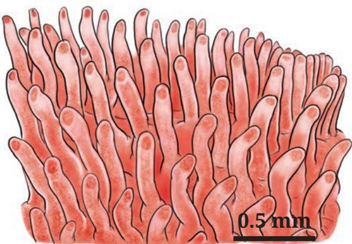
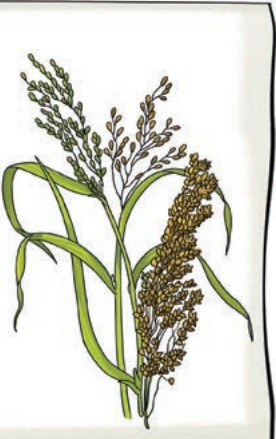

The **pancreas** secretes pancreatic juice, which is also basic in nature and helps neutralise acids present in the food. Additionally, pancreatic juice also breaks down carbohydrates, proteins, and fats. The digestive juice secreted by the wall of the small intestine further breaks down fats, proteins, and partially digested carbohydrates into simpler forms.

Fig. 9.5: Inner lining of the small intestine

The digested nutrients pass on from the small intestine into the blood present in blood vessels found in the walls of the small intestine. This process is called **absorption** of nutrients. How are these nutrients absorbed from the small intestine? The inner lining of the small intestine is thin and has thousands of finger-like projections (Fig. 9.5) that increase the surface area for efficient nutrient absorption. These finger-like projections allow the digested nutrients to pass into the blood, which carries them to different parts of the body. These nutrients provide energy, support growth and repair, and help the body function properly.

## SCIENCE AND SOCIETY

Celiac disease is a condition in which the body reacts to gluten, a protein found in wheat, barley, and rye. This reaction damages the inner lining of the small intestine, where nutrients are absorbed. As a result, the intestine cannot function properly. The only way to manage celiac disease is to avoid foods that contain gluten. Millets (like jowar, bajra, and ragi) are good alternatives because they are naturally gluten-free.

## Large intestine

After most of the nutrients are digested and absorbed in the small intestine, what happens to the undigested food? It moves into the large intestine. The large intestine is about 1.5 metres in length. It is shorter than the small intestine. Then why is it called the large intestine? The reason is that it is wider than the