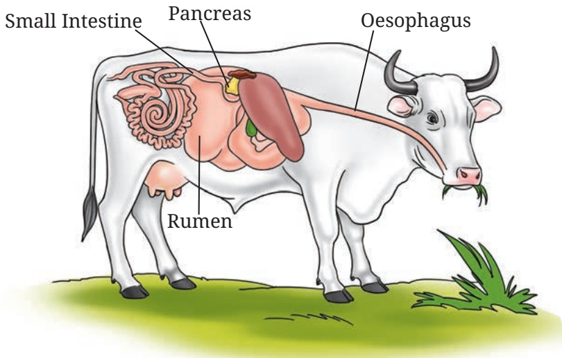
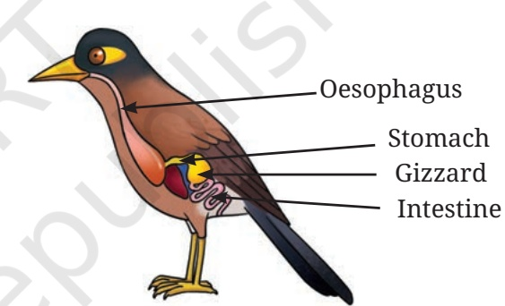

Fig. 9.6: Digestive system of a ruminant

Birds do not have teeth, but they have a chamber called a gizzard (Fig. 9.7). Food is broken down by the contraction and relaxation of the walls of the gizzard, often with the help of grit (small stones) that the birds swallow.

Grass-eating animals, such as cows (Fig. 9.6) and buffaloes, partially chew the grass and swallow it into their stomachs. In the stomach, partial digestion of the food takes place. The partially digested food is brought back to the mouth for gradual chewing. This process is called rumination, and these animals are called ruminants. A cow spends about 8 hours a day just chewing the food! The thoroughly chewed food again passes down the alimentary canal for further digestion.

Fig. 9.7: Digestive system in birds

This shows that animals exhibit variations in the structure and function of the alimentary canal to adapt to different ways of digesting different kinds of food.

We have learnt that the nutrients from digested food are carried to different parts of the body. Some of the nutrients help build and repair the body, while others, like sugar, are broken down inside the body to release energy. The process by which nutrients are converted into usable energy is called **respiration**. Let us now explore how this process occurs in animals.

## 9.2 Respiration in Animals

We learnt in Grade 6 chapter ‘Living Creatures: Exploring their Characteristics’, that all living beings respire. Is the process of respiration the same in all animals? Let us first understand the process of respiration in humans.