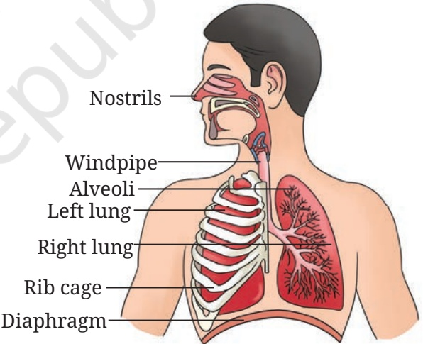
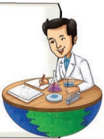

## 9.2.1 Respiration in humans

You know that we breathe in (inhale) and breathe out (exhale) air continuously to obtain oxygen and release carbon dioxide. How is this oxygen used in the body? Are breathing and respiration different? Let us find out.

## How do we breathe?

The process of inhaling and exhaling air is called breathing. It is difficult to live without food for a week; without water for a day or two, but without breathing, we usually cannot survive more than a few minutes. Why is that? All of us are alive because we breathe. Not just humans, plants and other animals also breathe. But how do we breathe?

Just as food follows a specific pathway in the digestive system, our body also has a specific system for breathing and respiration. This system is called **respiratory system.** The respiratory system consists of various parts as shown in Fig. 9.8. In this system, the exchange of gases follows a specific pathway. The pathway through which the air is inhaled and exhaled involves various parts of the respiratory system assisting in the process of breathing and respiration.

The respiratory system begins with a pair of nasal openings called **nostrils** through which we inhale and exhale air (Fig. 9.8). The inhaled air passes into a pair of small passages called the **nasal passages**. Have you noticed tiny hair inside your nostrils? These hair, along with mucus, help trap dust and dirt from the air we breathe in. This is why we should breathe through the nose and not through the mouth. From the nasal passages, the air reaches our lungs through the windpipe. The windpipe forms two branches, which enter the two lungs.

Fig. 9.8: Human respiratory system

In the lungs, these branches further divide into smaller and finer branches that end in small balloon-like sacs called alveoli (Fig. 9.8). Our lungs are protected by the rib cage.

## SCIENCE AND SOCIETY

While a lot of the dust is filtered out from the inhaled air, often small infectious particles can get through the lungs. For example, during the COVID-19 pandemic, the SARS-CoV-2 virus affected the respiratory system, leading to breathing difficulties and often causing serious lung problems.

