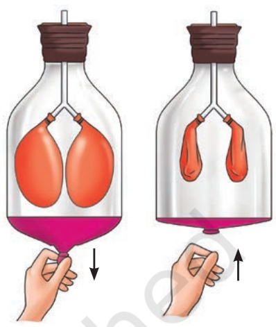
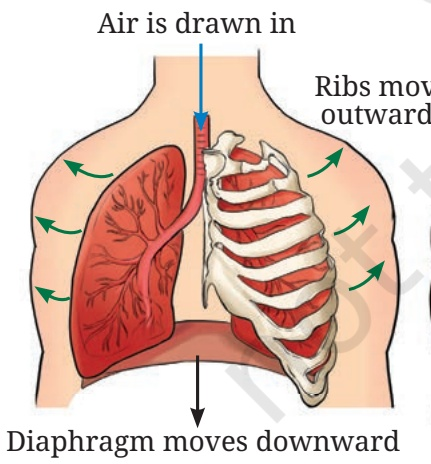
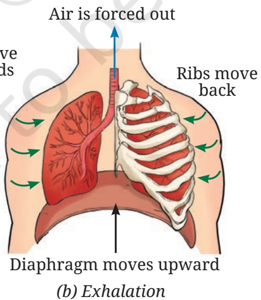

(b) Exhalation

(a) Inhalation

Let us understand the mechanism of breathing by making a simple model.

## Activity 9.2: Let us make a model

Take a wide transparent plastic bottle with a lid. Remove its bottom.

Make a hole in the lid of the bottle.

Take a Y-shaped hollow tube, as shown in Fig. 9.9.

Fix two deflated balloons to the forked end of the tube. Secure them with rubber bands to make them airtight.

Insert the straight end of the tube tightly through the lid from the open base of the bottle and seal the lid with clay to make it airtight.

Fig. 9.9: Model to show mechanisms of breathing

To the open base of the bottle, attach a thin rubber sheet tightly using a large rubber band.

Pull the rubber sheet from the centre of the base downwards and watch the balloons (Fig. 9.9a). What do you observe? Now, release the rubber sheet upwards and observe the balloons (Fig. 9.9b). What changes do you see in the balloons? When you pull the rubber sheet downwards, the balloons inflate. Conversely, when you release the rubber sheet upwards, the balloons deflate.

Fig. 9.10: Mechanism of breathing

When you breathe in (inhale), your chest expands as the ribs move up and outwards. The diaphragm (a dome-shaped muscle below the lungs) moves downwards during inhalation (Fig. 9.10a). This increases the space inside the chest, and air enters the lungs. When you breathe out (exhale), the ribs move down and inwards, and the diaphragm moves upwards (Fig. 9.10b), reducing space and pushing air out of the lungs.

