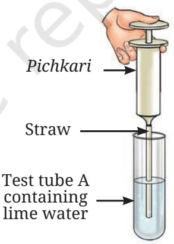
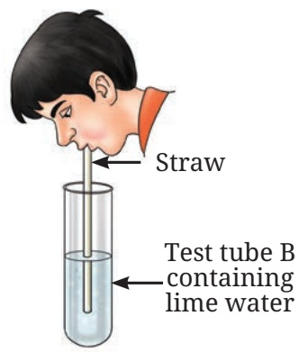

What do the balloons in the model mentioned in Fig. 9.9 represent? What does the rubber sheet represent? In this model, the balloons represent the lungs, and the rubber sheet represents the diaphragm.

## SCIENCE AND SOCIETY

## Breathing Practices for a Healthy Life

Breathing exercises have been practised across different cultures in India and worldwide for centuries. Pranayama is well known for improving respiratory health, mind relaxation, and concentration.

In Ladakh, people practise Tummo breathing, a technique that improves lung function and helps keep the body warm even in cold weather. Similarly, deep breathing techniques are used to promote well-being. Some traditions combine deep breathing with chanting, using rhythmic breath control to enhance relaxation and mental clarity.

## What do we breathe out?

## Activity 9.3: Let us explore

To be demonstrated by the teacher

Take an equal amount of freshly prepared lime water in two test tubes, A and B, as given in Fig. 9.11.

In test tube A, pass the air using a syringe/pichkari (Fig. 9.11a). This is the same air that you inhale.

In test tube B, repeatedly blow air through your mouth into the lime water using a straw (Fig. 9.11b).

(a)

(b)

Fig. 9.11: (a) Air is passed into lime water with a pichkari/syringe (b) Air is exhaled into lime water

Do you observe any changes in the colour of the lime water? The lime water in test tube B turns milky (or cloudy), but the lime water in test tube A does not. What does this indicate? Lime water turns milky when it reacts with carbon dioxide. Therefore, this indicates that the exhaled air contains more carbon dioxide than the air we inhale.