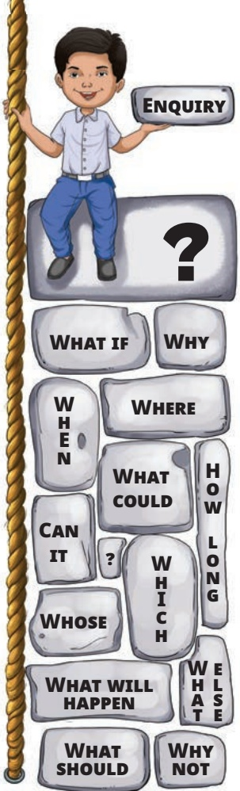

## Let Us Enhance Our Learning

1. Complete the journey of food through the alimentary canal by filling up the boxes with appropriate parts—

Food Mouth Stomach Anus

2. Sahil placed some pieces of chapati in test tube A. Neha placed chewed chapati in test tube B, and Santushti took boiled and mashed potato in test tube C. All of them added a few drops of iodine solution to their test tubes—A, B, and C, respectively. What would be their observations? Give reasons.

3. What is the role of the diaphragm in breathing?

(i) To filter the air

(ii) To produce sound

(iii) To help in inhalation and exhalation

(iv) To absorb oxygen

4. Match the following

## Name of the part

(i) Nostrils

(ii) Nasal passages

## Functions

(a) fresh air from outside enters

(iii) Windpipe

(b) exchange of gases occurs

(iv) Alveoli

(c) protects lungs

(d) tiny hair and mucus help to trap dust and dirt from the air we breathe

## (v) Ribcage

(e) air reaches our lungs through this part

5. Anil claims to his friend Sanvi that respiration and breathing are the same process. What question(s) can Sanvi ask him to make him understand that he is not correct?

6. Which of the following statements is correct and why? Anu: We inhale air. Shanu: We inhale oxygen. Tanu: We inhale air rich in oxygen.

7. We often sneeze when we inhale a lot of dust-laden air. What can be possible explanations for this?

8. Paridhi and Anusha of Grade 7 started running for their morning workout. After they completed their running, they counted their breaths per minute. Anusha was breathing faster than Paridhi. Provide at least two possible explanations for why Anusha was breathing faster than Paridhi.

