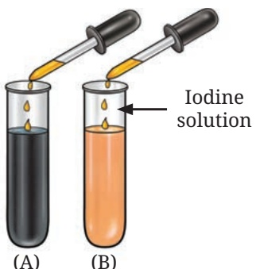
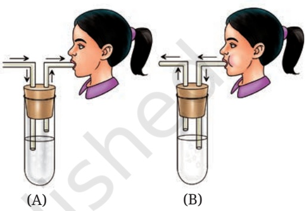
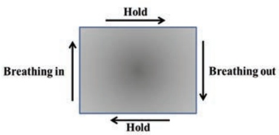
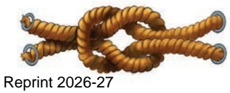

9. Yadu conducted an experiment to test his idea. He took two test tubes, A and B, and added a pinch of rice flour to the test tubes, halffilled with water and stirred them properly. To test tube B, he added a few drops of saliva. He left the two test tubes for 35–45 min. After that, he added iodine solution into both the test tubes. Experimental results are as shown in Fig. 9.15. What do you think he wants to test?

10. Rakshita designed an experiment taking two clean test tubes, A and B and filled them with lime water as shown in the figure. In test tube A, the surrounding air that we inhale was passed on by sucking air from the pipe, and in test tube B, the exhaled air was blown through the pipe (Fig. 9.16). What do you think she is trying to investigate? How can she confirm her findings?

Fig. 9.15: Experimental results

Fig. 9.16: Experimental set-up

## Exploratory Projects

What are the good practices for maintaining oral hygiene? Try to gather information on the same from books/newspapers/ conversation with elders. Prepare a report.

Find out different ways to maintain a healthy digestive system. Suggest some food items that help to maintain good digestive health. Make a report and present it in class.

Using coloured clay, prepare a 3-D model of the digestive system and label all parts of the digestive system using black paper strips.

What is air quality and AQI? Find out the effect of air quality on the respiratory systems of people working in various fields — farmers, factory workers, or street vendors.

Try to read about the box-breathing technique (Fig. 9.17). What are its benefits?

Both birds and mammals have lungs for breathing, but birds can fly at high altitudes where oxygen levels are low. How might their respiratory system be adapted to help them survive in such conditions?help them survive in such conditions?

Fig. 9.17: Box-breathing

