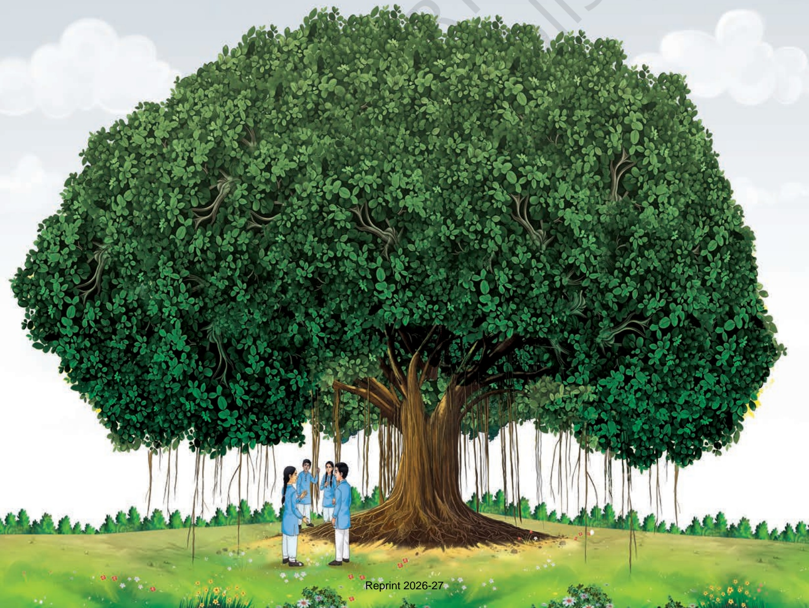

In Gra e 6, we learnt that all living beings grow and need food for their growth. Also, in the previous chapter, we discussed the process through which animals obtain nutrition.

We know that animals eat food to grow, but what about plants? Have you ever seen plants eating food like animals do? As animals grow, their size and weight usually increase, and their bodies undergo various changes. What changes do you notice in plants when they grow?

We learnt that food provides nutrients like carbohydrates, fats, proteins, vitamins, and minerals, which, along with water, are all essential for growth. Let us **explore** how plants obtain nutrients for their growth.

0777CH10

