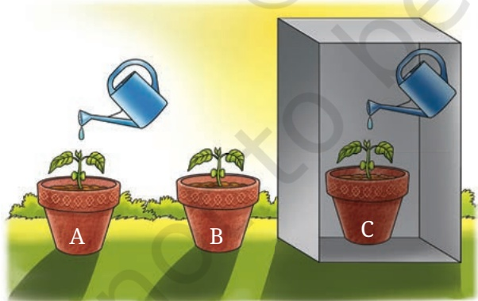

## 10.1 How Do Plants Grow?

Look around your neighbourhood. Have you observed any changes in a plant during its life span? As a plant grows, new leaves and branches emerge, its height increases, and its stem thickens. What do you think causes these changes? Discuss with your friends and provide your explanation as well.

When we water plants regularly, they grow better. So, I think water also contributes to its growth.

Maybe plants take up food from the soil through their roots.

I think sunlight plays some role in the growth of plants.

I think, maybe, plays some role!

Let us perform an experiment to test some of these explanations.

**Activity 10.1: Let us test some explanations**

Take three earthen pots (or used bottles/containers) of the same size filled with garden soil. Plant saplings of similar sizes

(a) Pot A kept in direct sunlight, with water

(b) Pot B kept in direct sunlight, without water

Fig. 10.1: Experimental set-up to understand the role of sunlight and water in plant growth

(c) Pot C kept in the dark, with water

of a fast-growing plant like chilli or tomato in each pot (Fig. 10.1).

Label the pots A, B, and C.

Count the number of leaves on each sapling and record your observations.

Place pot A in direct sunlight. Keep the soil in this pot slightly moist by adding an adequate amount of water every day (Fig. 10.1a).

Place pot B in direct sunlight, without adding water to the soil (Fig. 10.1b).

