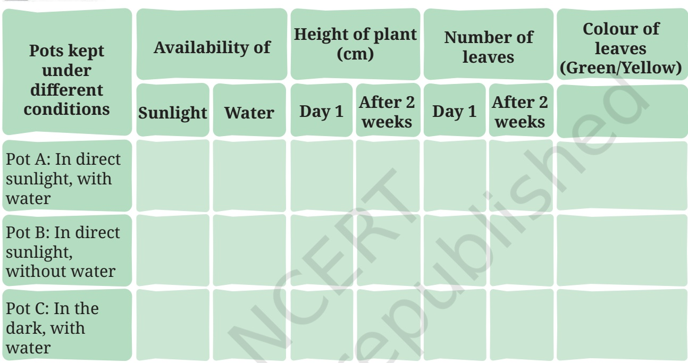

Place pot C in the dark. Keep the soil in this pot slightly moist by adding an adequate amount of water every day (Fig. 10.1c).

**Observe** the plants for two weeks1 and record changes in their height, number of leaves, colour of leaves, and any other changes that may appear.

**Record** your observations in Table 10.1.

Table 10.1: Effect of sunlight and water on plant growth

What differences did you observe between the plants in the three pots?

Which pot has the plant with the maximum growth?

Which pot has the plant with the least growth?

**Analyse** the observations recorded in Table 10.1, and discuss them with your teacher and friends.

You are likely to find that the plant in Pot A, kept in direct sunlight with adequate water, grows better than the plant in Pot C, which gets adequate water but no sunlight. The plant in Pot B may have died as it did not get water even though it received adequate sunlight.

What do you **infer** from the observations made in this activity? The results indicate that plants require both sunlight and water for their growth.

<small>1 This experiment will need two weeks. Teachers can plan this activity accordingly.</small>